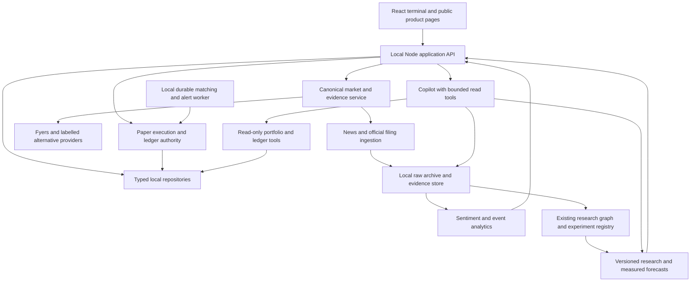

# Quant Plus: master implementation roadmap

Version 2, 2026-10-14. Grounded in [PROJECT_DEEP_AUDIT.md](PROJECT_DEEP_AUDIT.md).
Implementation evidence and remaining gates: [IMPLEMENTATION_STATUS.md](IMPLEMENTATION_STATUS.md).
Latest verified checkpoint: [ROADMAP_IMPLEMENTATION_20261015.md](ROADMAP_IMPLEMENTATION_20261015.md). Full roadmap completion remains open.
Provider decision updated: InsForge replaces Supabase. See [INSFORGE_MIGRATION.md](INSFORGE_MIGRATION.md).

## Objective and fixed constraints

Build an exceptional paper-trading platform whose market observations are real, whose simulated
accounting is correct, and whose AI is useful, grounded, and measured. “Best ever” is the ambition;
an evidence-based comparison is required before presenting it as an achieved fact.

Development and application runtime remain local until the user requests deployment.
The user has selected and linked InsForge project `ae254327-702a-47d6-a142-b1163ae5aa32`
to replace Supabase. Implement database/auth/storage/realtime against that provider;
do not deploy the app or enable real broker orders. The local store remains active
until the InsForge migration passes its gates. The linked backend is hosted;
local application runtime does not imply offline market/model/database availability.

Preserve uncommitted work and Lovable's published history. Implement small reviewable changes
with data backups and reversible migrations. The separate backend repository must be included in
the work when a phase touches its code, rather than pretending frontend changes fix the whole stack.

No artificial observed prices, candles, news, contracts, fundamentals, market scores, source health,
or claimed AI accuracy in the product. This applies to marketing pages too. Virtual deposits,
recorded paper trades, explicit user what-if calculations, configuration constants, skeletons,
nonquantitative decorative artwork, and isolated test fixtures are legitimate. Missing observations
remain unavailable; the product must remain usable with honest degraded states.

Keep AI research separate from account authority. Existing governance, frozen datasets, historical
failures, and deterministic risk boundaries remain intact. A promising backtest is not a live edge.

## Definition of quality

“Zero bugs” is operationalized as **zero known unresolved critical/high defects**, zero failing
required checks, zero unhandled errors in accepted workflows, and continuous regression/failure
testing. No engineering process can guarantee that every possible future defect has been eliminated.

The first release scorecard below is a proposed acceptance contract, not a claim of current results.
Freeze exact dataset splits and numeric thresholds before evaluating held-out outcomes.

| Dimension            | Required acceptance evidence                                                                                                                                                                                                               |
| -------------------- | ------------------------------------------------------------------------------------------------------------------------------------------------------------------------------------------------------------------------------------------ |
| Trading integrity    | Integer money/account reconciliation, no overselling/negative available cash, one settlement per intent, atomic ledger updates, valid quote provenance for every fill.                                                                     |
| Data truth           | Every displayed observation is sourced or derived reproducibly from sourced inputs; explicit delay/session/coverage/missingness. Zero runtime fixture/synthetic-market fallback imports.                                                   |
| Local durability     | Backup/restore and migration rehearsal; restart/crash recovery; server workers continue while browser tabs are closed; no cloud credentials needed.                                                                                        |
| Forecast honesty     | Target/horizon/cutoff, baseline, sample size, calibration status and model version attached. Unsupported confidence never represented as probability.                                                                                      |
| AI grounding         | Every factual numeric response has validated evidence/tool provenance; unsupported claims abstain; zero unauthorized account mutations.                                                                                                    |
| News quality         | Audited entity relevance, timestamp lineage, event clustering and correction handling on a labelled time-separated corpus.                                                                                                                 |
| Product completeness | Every advertised control works or is visibly disabled with a reason. Unsupported pages do not substitute fake data.                                                                                                                        |
| Reliability          | Typecheck, all required tests, zero-error/zero-warning lint target, Node build, browser flows, fault injection, restoration and market-session soak pass.                                                                                  |
| Performance          | On a documented reference machine: proposed p95 warm local reads <250 ms and durable order acknowledgement <500 ms, measured separately from provider latency/model inference. Reassess through measured baselines, not hidden relaxation. |
| Competitive claim    | A dated published benchmark for defined competitors/workflows, with repeatable tests and qualified conclusions. No unsupported universal ranking.                                                                                          |

## Architecture to converge toward

One authority for the user paper book, one canonical observation contract, and explicit adapters
around the existing providers and research engine. Avoid two independently writable copies of
cash/positions in Node and Python.

Selected application storage target: InsForge PostgreSQL behind typed repositories,
with transactional paper accounting and user-scoped access. Keep local immutable
raw/history archives where appropriate. Existing backend research SQLite stores can
remain separate experiment stores; they must not become a second writable user book.
See the provider migration plan for auth, grants/RLS and atomic settlement changes.

The Node/Python ownership decision must be made in Phase 2. Either Node owns the user book and
the Python worker calls its bounded internal API, or a dedicated local execution service owns it
and Node forwards requests. Both services must not write separate ledgers and then “sync” balances.
The backend's strategy-research ledger stays an explicitly separate research experiment book.

## Sequence, dependencies and rough effort

Effort is an initial range in focused engineering person-weeks, not a delivery promise. It includes
implementation/tests/review but excludes waiting for enough forward outcomes or data entitlements.
Re-estimate after Phase 0; feature scope, provider access and measured defects can change these ranges.

| Phase | Outcome                                                     | Dependencies                                  | Initial effort              |
| ----- | ----------------------------------------------------------- | --------------------------------------------- | --------------------------- |
| 0     | Reproducible baseline and complete requirements inventory   | None                                          | 0.5–1                       |
| 1     | Stop invalid trading and invalid research evidence          | 0                                             | 1–2                         |
| 2     | Durable local repositories, contracts and worker foundation | 1                                             | 2–3                         |
| 3     | Real data throughout the product                            | 2; immediate dummy suppression can start in 1 | 2–4                         |
| 4     | Realistic, auditable paper execution                        | 2 and canonical quote contract from 3         | 3–5                         |
| 5     | Reliable news and filing evidence engine                    | 2 and instrument/time contracts from 3        | 2–4                         |
| 6     | Measured sentiment and event intelligence                   | 3, 5 and correct maturity labels              | 2–4 plus data collection    |
| 7     | Better agentic research and evaluated forecasts             | 3, 5, 6 and clean PIT archives                | 3–6 plus forward evaluation |
| 8     | Grounded, persistent, tool-assisted copilot                 | 2, 3, 5; consumes 6/7 as ready                | 2–4                         |
| 9     | Complete trading workflows, portfolio tools and learning    | 3, 4; uses 6–8                                | 3–5                         |
| 10    | Failure-tested, polished release and honest comparison      | All required prior gates                      | 2–3 plus session soak       |

Do not sum these into a fixed calendar deadline. Parallel development is possible for independent
modules, but data collection, review and gate dependencies determine release order. Once Phase 2
provides durable storage, start append-only news/forecast observation collection early. Do not
wait until an attractive AI UI is built to start collecting outcomes.

Every phase produces: a bounded change list, updated contracts, tests, measured results, known
limitations, migration/backout instructions where relevant, and a gate decision. “Mostly implemented”
is not a passing gate.

## Phase 0 — establish the baseline

Deliverables:

1. Record current git status in both repositories, runtime versions, dependency locks, schema
   versions and source fingerprints. Preserve all existing changes; do not rewrite history.
2. Create a feature-to-data-to-action inventory for every route and every visible action. Each
   quantitative field gets a source/formula/missing-state entry; each action gets its handler,
   side effects, error path and test status.
3. Adopt the audit IDs as a defect register with evidence, severity, reproduction, owner/module,
   dependency and desired behavior. Record the ten diagnostic cases as failing desired-behavior
   tests rather than leaving current defects asserted as successes.
4. Make backend tests hermetic: explicit dummy keys, isolated DB/raw/cache/log/output paths,
   frozen clocks, blocked unintended network/model calls, and no generated artifacts in the
   active backend. Put live provider tests in a separate opt-in suite with hard deadlines.
5. Document actual supported instrument/product/order scope. Current delivery equities and
   research-only AI are the starting point; absent derivatives capability is not implied support.
6. Choose one package manager/lock policy and reproducible Python dependency constraints.
   Reconcile stale Supabase instructions and false completed-feature checklists.
7. Add browser-test infrastructure and a route/action coverage manifest. Capture a baseline for
   failures, unavailable states, navigation, and accessibility rather than testing only happy paths.

Gate: a fresh local checkout can start without cloud database credentials; required checks can
run without real model keys or provider connectivity; all known blockers have reproducible cases;
every product field/action appears in the inventory. Live checks are separately labelled.

## Phase 1 — repair integrity blockers

Primary findings: EXEC-01 through EXEC-07, STORE-01/02, SENT-01/02, AI-01/02, DATA-01/02.

Deliverables:

1. Add stable order-intent IDs and idempotency keys. Persist request fingerprint and response.
   Replaying the same key/payload returns the same result; reusing it with a changed payload
   rejects. Different user intents get different keys. Fund mutations need the same retry safety.
2. Centralize server quote eligibility: positive finite price, verified symbol/source, explicit
   timestamps, bounded future clock skew, delay/staleness, exchange session, and maximum
   closed-snapshot age. Store provider observation, receipt, and decision times distinctly.
3. Separate regular paper trading from last-session practice. Closed-session practice needs an
   explicit mode and bounded last-session snapshots; it must not look like a live exchange fill.
4. Define daily-loss semantics and enforce them on new/increased exposure server-side. Use a
   cash-flow-adjusted day-start equity/realised-and-unrealised policy; do not use lifetime profit
   as “today's loss.” A pause or loss cap must still permit validated risk-reducing exits.
5. Add exchange-session expiry for DAY orders and an expiration event/status. Require accurate
   holdings for exits; replace recent-order-derived positions and average cost in the Orders page.
6. Validate all editable records and all policy fields with explicit runtime schemas. Reject null
   arrays, unsupported enum values, malformed IDs/symbols, nonfinite values and unknown fields
   rather than trusting TypeScript casts.
7. Stop daily candle/filing lookahead: record bar start/end/available_at and enforce completion
   at the decision cutoff. Historical cutoffs must not receive current snapshots from any future
   observation. Fix 52-week labels/windows and invalidate affected cached evaluation eligibility.
8. Correct sentiment outcome maturity, session timezone/calendar handling and missing signal
   denominators. Quarantine incorrect labels; preserve originals for audit.
9. Suppress synthetic market fallbacks and fixed observational metrics immediately. Hide/disable
   unsupported surfaces while their real-data replacements are being implemented.
10. Make browser-only protection limitations explicit until Phase 2/4 workers own them. Prevent
    duplicate bracket submissions through server idempotency; do not claim unattended protection.

Gate: all ten reproduced defects have desired-behavior regression tests that pass; repeated intents
settle once; future/obsolete quotes cannot fill; risk controls permit reductions; DAY expiry works;
positions reconcile to holdings; historical decisions cannot see unclosed candles/future snapshots.
No known P0 integrity defect remains open. A future newly found P0 reopens this gate.

## Phase 2 — make local storage durable and explicit

Primary findings: STORE-03/04, SENT-03, EXEC-07, CHAT-04, OPS-01/02.

Deliverables:

1. Replace the partial Supabase-shaped facade with typed repositories: accounts, funding,
   orders, fills, holdings/lots, ledger, risk policies, alerts, journal, watchlists, preferences,
   conversations, evidence, forecasts and job state.
2. Establish the single book owner described above. Introduce versioned InsForge PostgreSQL migrations,
   integer minor units for money, explicit quantity/tick scales, indexes, foreign keys,
   uniqueness constraints and atomic command transactions.
3. Migrate existing JSON data once with validation and cash/position reconciliation. Keep a
   dated backup and hash; no automatic reset on malformed data. Bad rows are quarantined
   with a visible repair report. Preserve order IDs and journal links.
4. Add an append-only account/event ledger, outbox for worker notifications, monotonic event
   sequence, idempotency records and durable scheduler jobs with claims, leases and retries.
5. Persist sentiment/news/forecast observation history locally. Persist conversation state and
   research/job progress locally without conflating the account book with strategy experiments.
6. Enforce internal service authentication and loopback binding for every mutation/compute
   endpoint, including legacy backend control/evaluation/WS paths. Keep frontend keys private
   and do not imply that a local profile is multi-user authentication.
7. Add backup/restore, schema migration verification, disk-full/permission/corruption handling,
   controlled shutdown and restart recovery. Document local paths and retention.

Gate: migration preserves the existing book; restored state reconciles exactly; crashes around
commit cannot cause half-settlement or duplicates; workers recover claims; disk/DB failures produce
actionable errors; two service processes cannot independently overwrite the same book.

## Phase 3 — remove all dummy data and unify market truth

Primary findings: DATA-01 through DATA-07, NEWS-01, UX-03, DOC-01.

Deliverables:

1. Define one observation envelope: instrument ID, value/unit, provider, provider timestamp,
   received_at, available_at, bar completion, session ID/status, delayed/stale/quality/coverage,
   methodology/version, lineage/snapshot ID and unavailable reason.
2. Build an instrument master with exchange, ISIN or verified identifiers, symbol aliases and
   effective dates, lot/tick sizes, product/segment support, corporate actions and official
   membership changes. Static metadata is acceptable only when versioned/verified; no seeded
   prices, guessed weights, guessed contracts, or fabricated identifiers.
3. Use a canonical exchange calendar for holidays, half/special sessions and session boundaries.
   Verify against the official calendar and provider state.
   [NSE session information](https://www.nseindia.com/resources/exchange-communication-holidays).
4. Add plan-aware Fyers subscription/request budgets, priority allocation, batching,
   single-flight requests, bounded reconnects, circuit breakers and per-symbol health. A
   connected socket alone is not evidence that the requested quote is executable.
   [Official FYERS limits](https://support.fyers.in/portal/en/kb/articles/what-are-the-fyers-api-rate-limits-for-standard-and-prime-plans).
5. Share quote subscriptions in the frontend. Normalize/deduplicate/sort symbols, partition
   large watchlists, release unused subscriptions, reject out-of-order ticks and bound stream
   buffers. Treat partial coverage and disconnects separately.
6. Replace all generated charts with provider history. Validate OHLC ordering, prices, volumes,
   duplicate times, corporate-action adjustments, gaps and partial bars. Expose which values
   are completed candles versus an updating bar; add real RSI/EMA/MA with documented warmup.
7. Replace fixed metrics in Markets, watchlist, research, source health, context coverage,
   screener and portfolio. Unavailable factors cannot satisfy active filters silently.
8. Replace public demo tapes/numbers with real read-only snapshots or nonquantitative visuals.
   Split instrument metadata from observations and remove unused synthetic helpers.
9. Leave Options/Replay explicitly unavailable until validated real contracts/history can be
   delivered in Phase 9. Do not retain artificial data merely because it is labelled demo.
10. Add a build/import audit that fails if product routes consume fixtures or synthetic market
    generators. Review computed defaults separately so legitimate formulas are not banned.

Gate: disconnect every external source and confirm the whole product shows honest unavailable
states instead of invented values. Reconnect and verify observation lineage across every route.
Zero runtime dummy-market imports or hardcoded observational statistics. All active factor filters
have measured inputs; missing ones are handled explicitly.

## Phase 4 — build a realistic paper-execution engine

Primary findings: EXEC-01 through EXEC-09; requires Phase 3 market/time contracts.

Deliverables:

1. Formalize the order state machine: pending validation, accepted/open, partially filled,
   filled, cancelled, expired, rejected and recovery states. Persist amendments/cancellations,
   parent/child relationships, execution reasons and version checks.
2. Add a durable local matching worker for resting limits/stops, brackets, OCO and trailing
   protection. Store peaks and trigger evidence server-side. One claim/transaction wins when
   several tabs/workers see the same condition; enforce remaining parent-position quantity.
3. Fill against documented available evidence: bid/ask when valid, last-trade assumptions when
   only that source exists, observable liquidity limits, simulated latency/slippage and partial
   fills. Persist the simulation method and uncertainty. Do not claim queue-accurate exchange
   simulation without order-level data.
4. Add cash/share reservations for resting orders; release them on cancel/expire; recheck risk
   at fill. Prevent concurrent orders from each consuming the same cash or shares.
5. Debit itemized versioned fees/taxes appropriate to supported instrument/product and date.
   Verify current schedules before implementation. Keep statutory charges, broker assumptions,
   exchange charges and settlement/DP assumptions distinct; do not hardcode one universal rate.
6. Use marked equity for concentration and day-loss controls with explicit stale-valuation
   policy. Implement exposure/cash-flow accounting, settled/unsettled balances, corporate
   actions, and exact ledger reconciliation. Enable products only after their rules are supported.
7. Implement server basket preflight and per-leg durable IDs. Choose and display either
   independent-leg behavior or reserved all-or-reject validation; report actual partial outcomes.
   Retrying failed legs must not repeat successful legs. Estimates with missing inputs are unknown.
8. Add trade/execution audit views: intention, quote, validation, reservation, trigger, fill,
   charges, resulting ledger and event times. Provide export/reproduction for a disputed fill.

Gate: accounting/property tests survive randomized order/funding sequences; each intent settles
once; zero unexpected cash/share violations; bracket/limit jobs continue with the browser closed
while the local worker and feeds remain running. Restart, duplicate delivery, gap, halt, stale tick,
partial fill, cancel/fill race and daily rollover tests pass.

## Phase 5 — strengthen news and filing acquisition

Primary findings: NEWS-01 through NEWS-04, AI-02, SENT-03.

Deliverables:

1. Add a durable connector registry with typed source status, entitlements, schema version,
   deadlines, retry/backoff, circuit breakers, conditional retrieval and source-specific budgets.
   Keep RSS discovery; add official NSE/BSE filings and other permitted sources behind adapters.
2. Preserve raw payload/hash, canonical link, publisher, published/updated/broadcast time,
   first_seen/available_at, timezone, language and retrieval outcome. Correct timezone-less
   dates using documented source semantics; quarantine ambiguous times rather than guess.
3. Separate missing news from provider failure. Enforce future-age bounds and retain corrected
   timestamps with lineage instead of rewriting the historical archive.
4. Use instrument/issuer aliases, subsidiaries, namesakes, ISINs and effective corporate changes
   for entity linking. Label ambiguous company references; support mixed Hindi/English with
   measured language handling rather than English-only fuzzy assumptions.
5. Cluster events instead of simply deleting similar stories. Keep the earliest known evidence,
   syndication links, distinct numbers/periods/directions, amendments, retractions and update
   versions. Cap cluster influence so ten copies do not become ten independent signals.
6. Where access permits, ingest original attachments/XBRL and relevant document spans. Preserve
   licensing/usage terms and provenance. Validate permitted URLs, content type/size, XML/PDF
   parsing and download isolation. Do not solve coverage by unrestricted publisher scraping.
7. Extract typed events: issuer, event type, period, currency, magnitude, comparison baseline,
   actual-versus-estimated result, certainty, affected business/sector and supporting span IDs.
   Uncertain or unsupported fields abstain.
8. Schedule persistent incremental collection/backfill and measure source latency, coverage,
   outages, relevance, duplicate clustering and correction propagation.

Gate: a real labelled test corpus contains at least 1,000 candidate stories/events, grouped by
event and separated by time; include namesakes, contradictory numbers, old/updated stories,
rumours and multilingual cases. Proposed relevance precision target >=95% with coverage/recall
and confidence intervals reported. Freeze the target before test evaluation; disclose missing
entitlements. All scored news has observation-time evidence and correction lineage.

## Phase 6 — improve sentiment with measured uncertainty

Primary findings: SENT-01 through SENT-04, NEWS-03/04.

Deliverables:

1. Separate textual tone, entity-specific economic impact, market participation/risk regime,
   observed price reaction and forward forecast. A positive headline is not automatically a
   bullish stock forecast; market sentiment index/coverage is not probability of a return.
2. Retain deterministic components as a transparent baseline. Evaluate a domain NLP classifier,
   entity/event-aware model and bounded LLM extractor as challengers. FinBERT is a baseline
   candidate, not a guaranteed upgrade on Indian news. [FinBERT research](https://arxiv.org/abs/1908.10063).
3. Build human-reviewed labels with written guidelines, reviewer disagreement/adjudication and
   balanced slices for negation, speculation, comparison periods, earnings surprises, sector
   sensitivities and mixed language. Prevent event-cluster/issuer/time leakage between splits.
4. Measure macro-F1, relevance calibration, precision/recall per event/entity/language, abstention
   coverage and drift. Proposed NLP macro-F1 target >=0.80 and improvement over current rules
   on a frozen corpus; set per-slice minimums and confidence intervals after the pilot, before
   inspecting the final holdout.
5. Correct the local history/calibration maturity worker. Use completed exchange bars, exact
   horizon/session definitions, historical membership and split-adjusted data. No outcome is
   settled before its maturity; no missing future bar is interpolated into an outcome.
6. Calibrate actual classification/forecast probabilities using training/validation outcomes;
   assess Brier/log loss and reliability separately from heuristic coverage confidence.
   Calibration techniques need dataset-specific validation. [Calibration research](https://arxiv.org/abs/1706.04599).
7. Make market sentiment weights/sources/version/coverage visible, account for correlated inputs,
   and test missingness, low liquidity, extremes and regime changes. Dynamic weighting remains
   experimental until it wins a pre-registered comparison.
8. Measure news reaction around actual publication/availability windows against appropriate
   market/sector controls. Keep descriptive reactions distinct from causal claims and future
   predictions; do not use the same-day price move to validate its own sentiment score.

Gate: timestamp/maturity invariants pass; real-corpus NLP beats its frozen baseline with acceptable
coverage; calibrated probabilities have sufficient resolved samples and proper uncertainty.
Sentiment can ship as descriptive analytics without directional edge, but predictive claims need
time-separated forward evidence. Null reliability remains null when a signal has no sample.

## Phase 7 — upgrade agentic research and predictions

Primary findings: AI-01 through AI-04. Depends on clean evidence, not just a larger model.

Deliverables:

1. Use a shared immutable decision-time evidence bundle: prices/bars, filings as-filed, verified
   events/news, technical factors, macro/sector state and source quality. Retain raw snapshot
   fingerprints and available_at filtering through every stage.
2. Require claim-level evidence IDs and deterministic numerical facts. Agents may interpret
   facts; they may not invent signal values, ratios, filing dates or quoted sources. Validate
   supporting references, contradictory claims and typed outputs before synthesis.
3. Improve agent specialization only where ablations support it: technical/volatility, filings,
   event/news, macro/sector, portfolio/risk, synthesis and independent falsification. Prefer a
   smaller useful graph to many correlated agents repeating the same model opinion.
4. Add structured hypotheses, falsifiers, counterfactual conditions, uncertainty reasons and
   evidence sufficiency. Preserve prior failures and distinguish new evidence from rediscovery
   of an already rejected idea. Maintain abstention as a valid result.
5. Separate research prose from numeric forecast models. Define horizon/target contracts
   (e.g. return distribution and threshold event) for each supported timeframe; do not silently
   repurpose the existing 20-trading-day evaluation into an intraday prediction claim.
6. Evaluate simple market/sector/constant and technical baselines before statistical challengers.
   Use training/validation/untouched temporal test sets, purged overlapping targets where
   needed, point-in-time membership, corporate actions, regime slices and cost assumptions.
   Separate exploratory/burned data from promotion datasets.
7. Register each model/prompt/data/config change as an experiment. Track inference/data cost,
   coverage, Brier/log loss, accuracy where meaningful, latency and abstention. Use clustered
   uncertainty estimates and multiple-testing controls; do not promote by best-of-many trials.
8. Keep checkpoint/resume, job coalescing, operator pause, key budgets and request warming.
   Add fair foreground/background scheduling, cancellation, stage deadlines and evidence-aware
   cache invalidation. Distinguish cached delivery latency from new research turnaround.
9. Maintain a forward forecast registry and outcome worker. Provisional minimum: 500 matured
   forecasts per claimed horizon before a promotion review; effective sample size and a
   pre-registered power analysis may require more because observations are correlated.
10. Show horizon, cutoff, evidence quality, model version, calibration status, sample size,
    disagreement and baseline comparison in the UI. “Agent conviction” stays opinion until
    an explicitly validated mapping makes it a calibrated probability.

Gate: no PIT leakage; schema/evidence checks pass; every model change has an ablation/cost result;
cached/progress UX works without hiding failures. Any directional superiority claim must meet
frozen out-of-sample and forward gates versus appropriate baselines, net of modeled costs, with
uncertainty reported. If it fails, ship useful research/risk explanation with an honest unproven
label. Existing contaminated/failed artifacts stay preserved and excluded from promotion evidence.

## Phase 8 — turn Quant AI into a grounded copilot

Primary findings: CHAT-01 through CHAT-04, DATA-02, UX-02.

Deliverables:

1. Replace regex word guessing with instrument/entity resolution and explicit attached context
   from the current page, selected stock, order, journal entry or portfolio. Resolve ambiguity
   before costly retrieval; keep dialogue context out of naive three-token symbol caps.
2. Add bounded typed read tools for quotes/history/factors, news/events/filings, saved research,
   forecast results, order/fill ledger, portfolio/risk and journal. Compute numbers in tools.
3. Retrieve supporting spans/snapshots and return structured answer metadata: source IDs,
   observation/cutoff times, coverage, tool trace and uncertainty. Cite evidence inline; validate
   IDs and numeric claims before displaying authoritative factual statements.
4. Keep external headlines/documents untrusted, isolate tool permissions and reject attempts
   to turn retrieved text into instructions. Red-team malicious headlines, conflicting evidence,
   invented ticker names and unavailable data.
5. Persist conversations locally with search/export/delete, explicit retention, evidence links
   and user-controlled memory. Share one tested stream consumer across dock, full chat and
   journal review. Add Stop/retry/resume behavior, disconnect cancellation and request budgets.
6. Add workflow modes: explain a move, compare evidence, portfolio concentration/stress,
   pre-trade evidence review, journal process review and post-trade execution review. Teach
   the difference between uncertainty, exposure and forecast probability.
7. Replace fixed context-completeness gauges with actual retrieval status. Add model/provider
   health, rate-limit handling, token/cost accounting and configurable spending ceilings.
8. Start read-only. If paper-action previews are later added, they must use deterministic
   validated quantities/policies, show a concrete preview and require explicit user submission
   through the paper boundary. Never give the chatbot broker authority.

Gate: a frozen adversarial/workflow set checks answer grounding, source correctness, numerical
accuracy, abstention, injection resistance, cancellation and cost limits. Proposed factual citation
precision >=95% on >=200 reviewed answers; validated numerical tool results must match exactly
within documented rounding. Any unsupported number/citation triggers correction or abstention.
Zero unauthorized mutations, and restored conversations retain their evidence cutoff.

## Phase 9 — complete the rest of the platform

Primary findings: DATA-03/06, UX-01 through UX-03, EXEC-06/09.

| Area                     | Upgrade                                                                                                          | Acceptance evidence                                                                                                                               |
| ------------------------ | ---------------------------------------------------------------------------------------------------------------- | ------------------------------------------------------------------------------------------------------------------------------------------------- |
| Dashboard / Markets      | Real factors/breadth/history, coverage, configurable panels and real source health.                              | Every metric has lineage; source failure produces no fabricated fallback.                                                                         |
| Charting                 | Validated RSI/EMA/MA, time axes, crosshair, range/zoom, real volume, annotations and event overlays.             | Reference indicator comparisons, warmup/gap tests, keyboard/touch behavior.                                                                       |
| Screener                 | Measured technical/fundamental/event/forecast factors, missing-data policy, saved versioned screens.             | Active constraints cannot pass unknown fields; factors match backend formulas.                                                                    |
| Portfolio / X-ray        | Marked equity, realised/unrealised net P&L, attribution, exposure/correlation and explicit what-if stress.       | Reconcile to fills/ledger; no stale mark represented as live; sufficient history for statistics.                                                  |
| Wallet / Orders / Basket | Complete searchable/paginated ledger, accurate holdings/lots, reservations, batch preview and per-leg results.   | More than 60 orders do not change position truth; retried baskets do not duplicate legs.                                                          |
| Risk                     | Day loss, marked concentration, scenario controls, risk-reducing exit policy and visible enforcement reasons.    | Guardrail changes persist and affect only their documented controls.                                                                              |
| Alerts                   | Durable price/move/volume/event/news conditions with delivery history, debouncing and cooldown.                  | Every exposed alert type is implemented; notifications survive restart and deduplicate.                                                           |
| Journal / review         | Predecision snapshots, immutable timestamps, linked intents/fills, process rubric, coaching and outcome history. | Reviews retrieve the actual linked trades, not arbitrary same-symbol recent fills; no unvalidated “Trading IQ” ability claim.                     |
| Replay                   | Recorded real historical bars/news/events, isolated replay account/clock and no future information.              | A replay decision sees only evidence available at replay time; source archive and reproducible seed/time policy exist.                            |
| Options                  | Real contract master, observed chain/bid/ask/OI, dated lot/expiry rules, validated IV/Greeks and strategy risk.  | No seeded IV/guessed lots; payoff extrema distinguish sampled range from mathematical max/min. Remain disabled if permitted chain data is absent. |
| Research / committee     | Actual reports, evidence graphs, disagreement, stage/job traces, experiment and calibration status.              | Generate brief has a real bounded job; failures/progress are persisted, not timer animations.                                                     |
| Settings / help          | Working preferences/theme/density/reduced-data behavior, real save/error feedback, truthful local-profile copy.  | Every setting has an observable consumer/test or is removed.                                                                                      |

Add keyboard-first navigation, accessible dialogs/focus, clear destructive-action feedback, responsive
layouts and reduced-motion support. Keep optional expensive features behind readiness checks;
disabled honest functionality is preferable to fabricated readiness, but it does not count as complete.

Gate: route/action inventory is fully exercised in browser tests; every advertised feature is
implemented or explicitly excluded from the release scope. Zero no-op controls and product dummy
data. Options are not declared complete without actual input entitlements and contract validation.

## Phase 10 — prove reliability and comparative quality

Deliverables:

1. Enforce clean typecheck/tests/build and zero-warning lint. Add runtime contract fuzzing,
   accounting/property tests, API boundary tests and complete browser workflow coverage.
2. Inject provider disconnects, stale/out-of-order data, clock skew, partial payloads, revoked keys,
   429s, model timeouts, malformed model output, DB contention, disk-full conditions, crash points,
   duplicate event delivery, simultaneous tabs and worker restarts.
3. Run at least 10 consecutive trading-session soaks on the reference local setup, including a
   controlled reconnect/restart and a calendar/rollover rehearsal. Track unhandled errors, queue
   lag, quote eligibility, reconciliation, source coverage and local resource usage. This is a
   readiness sample, not a universal reliability guarantee.
4. Benchmark cold versus warm reads, new research versus cached delivery, full watchlist capacity,
   large account histories and chat responsiveness. Publish p50/p95/p99 with machine, dataset,
   source state and request count; do not reuse an in-process microbenchmark as end-user latency.
5. Perform restore/migration drills and compare ledger/snapshot hashes. Define incident recovery,
   health diagnostics and operator pause behavior. Produce a versioned local release manifest.
6. Compare a declared set of available paper-trading tools on accounting realism, workflow
   completeness, evidence grounding, accessibility, latency and evaluated AI usefulness. Refresh
   competitor facts at comparison time; separate unavailable measurements from actual wins.
7. Make release claims correspond to measured results. Failed superiority/forecast gates do not
   block an honestly labelled research tool, but they block claims that the failed capability is
   proven. Never hide excluded tests, missing feeds or insufficient sample sizes.

Gate: no open P0/P1 defects in the agreed release scope; all required automated/browser/fault/soak
checks pass; zero dummy observed data; restored accounts reconcile; AI evidence and benchmark
reports are reproducible. InsForge is selected for the backend; app deployment remains a separate user decision.

## First implementation batch

Start with a compact Phase 0/1 slice, not simultaneous model rewrites:

1. Isolate tests and commit the defect register/acceptance cases for review.
2. Fix server quote future/closed-age checks and daily-bar completion PIT rules.
3. Add idempotency, risk-reducing exit handling and enforce the daily-loss policy.
4. Correct positions/average cost and DAY expiry.
5. Add table-specific local schemas and correct sentiment maturity/empty-denominator behavior.
6. Remove the most misleading synthetic charts/fixed metrics, disable artificial Options/Replay.
7. Demonstrate those fixes with integration/accounting tests and a local restart exercise.

Then proceed to durable local repositories and workers. News collection can start once its
timestamps/archive are trustworthy; AI quality promotion must wait for the evidence gates.

## Decisions to resolve during their phases

Use best judgment for routine implementation details. Record concrete choices before their
dependent work; InsForge is selected, while application deployment remains unrequested.

| Decision                              | When                                | Current working assumption                                                         |
| ------------------------------------- | ----------------------------------- | ---------------------------------------------------------------------------------- |
| Paper-book service owner              | Phase 2                             | One local authority; preserve research strategy ledger separately.                 |
| Application database and SDK          | Phase 2                             | InsForge PostgreSQL and `@insforge/sdk`; validate contracts and migrations first.  |
| Supported execution scope             | Phase 0/4                           | Delivery equities first; other products only after rules/data exist.               |
| Closed-session practice               | Phase 1                             | Separate explicit practice mode, not ordinary live fill semantics.                 |
| Fyers entitlements                    | Phase 3                             | Detect/configure actual plan limits; never assume Prime capacity.                  |
| News/document rights and coverage     | Phase 5                             | Permitted public/official or separately entitled connectors; no invented coverage. |
| Forecast horizons and promotion gates | Phase 7 preregistration             | Preserve old definitions; new horizons are separately versioned experiments.       |
| Model challengers and spending limits | Phase 6/7/8                         | Measure current models first; no unannounced paid fallback/model change.           |
| Backend provider / app deployment     | Provider selected; deployment later | InsForge project linked; keep app development local until deployment is requested. |

Track completion by delivered evidence and gates, not by checkmarks for UI presence. This document
is the current planning reference; earlier roadmap files remain historical until reconciled in Phase 0.
