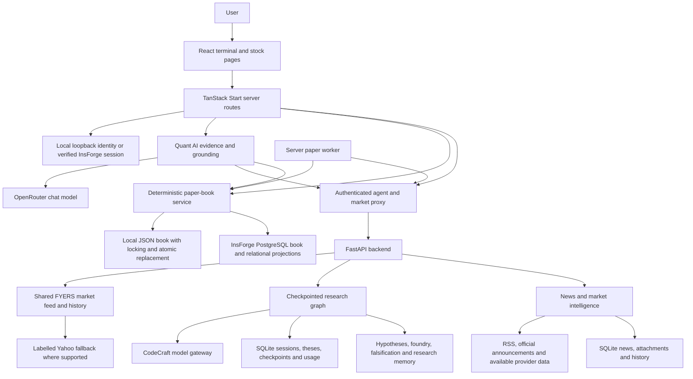
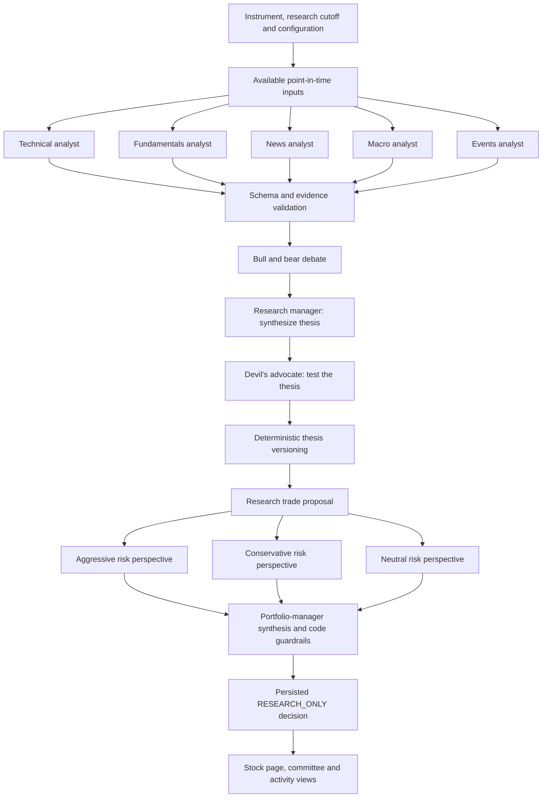
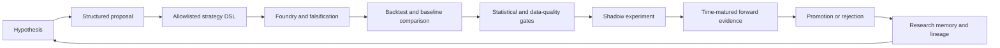
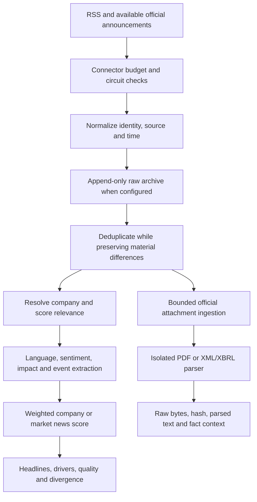
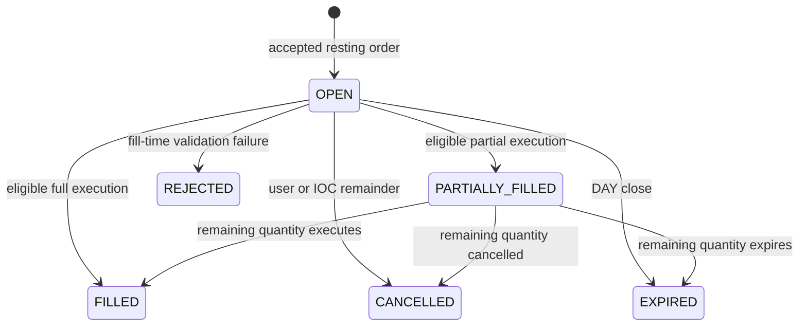

# Quant Plus

## An agentic research and paper-trading platform for Indian equities

**Project presentation and technical dossier · 15 October 2026**

> Our idea is to bring market observation, specialist AI research, opposing viewpoints, news intelligence, risk controls and realistic paper trading into one workspace. A user should be able to understand a stock, question the reasoning, practise a decision, and inspect the resulting accounting and evidence.

**Current position:** a substantial local platform with tested market-data integration, a multi-agent research pipeline, sentiment and news engines, and a durable paper-trading book. InsForge authentication and hosted persistence are implemented, and the selected local portfolio has been imported and reconciled. Hosted runtime cutover and several product and empirical validation gates remain open.

This document describes the project we have built and the larger idea behind it. Measured results carry their date and scope. Product ambitions, implemented mechanisms, historical experiments and unverified claims are identified separately.

---

## Contents

1. [The idea and motivation](#1-the-idea-and-motivation)
2. [Who the platform serves](#2-who-the-platform-serves)
3. [What makes the approach distinctive](#3-what-makes-the-approach-distinctive)
4. [A user journey through the product](#4-a-user-journey-through-the-product)
5. [Product modules and implementation status](#5-product-modules-and-implementation-status)
6. [Full system architecture](#6-full-system-architecture)
7. [The agentic stock-research pipeline](#7-the-agentic-stock-research-pipeline)
8. [The research operating system](#8-the-research-operating-system)
9. [Models, orchestration and inference economics](#9-models-orchestration-and-inference-economics)
10. [Market data, sources and coverage](#10-market-data-sources-and-coverage)
11. [Data integrity and point-in-time research](#11-data-integrity-and-point-in-time-research)
12. [News and official-document intelligence](#12-news-and-official-document-intelligence)
13. [Stock and market sentiment](#13-stock-and-market-sentiment)
14. [Quant AI: the evidence-aware copilot](#14-quant-ai-the-evidence-aware-copilot)
15. [The paper-trading and accounting engine](#15-the-paper-trading-and-accounting-engine)
16. [Identity, persistence and security](#16-identity-persistence-and-security)
17. [Measured engineering benchmarks](#17-measured-engineering-benchmarks)
18. [Forecast accuracy and historical research results](#18-forecast-accuracy-and-historical-research-results)
19. [Testing, recovery and operational evidence](#19-testing-recovery-and-operational-evidence)
20. [Engineering challenges we solved](#20-engineering-challenges-we-solved)
21. [Technology stack and repository map](#21-technology-stack-and-repository-map)
22. [The remaining roadmap](#22-the-remaining-roadmap)
23. [Product potential and future business direction](#23-product-potential-and-future-business-direction)
24. [A suggested presentation and demonstration](#24-a-suggested-presentation-and-demonstration)
25. [Questions a reviewer is likely to ask](#25-questions-a-reviewer-is-likely-to-ask)
26. [Evidence index and terminology](#26-evidence-index-and-terminology)

---

## 1. The idea and motivation

### The problem we wanted to solve

Researching a stock can become a fragmented process: prices in one application, charts in another, news in a third, financial documents elsewhere, and trade notes in a spreadsheet. A buy or sell opinion may appear without a clear explanation of the data cutoff, opposing evidence, execution assumptions or confidence limitations.

We wanted a workspace that connects those steps. The intended outcome is a complete learning and research loop:

**Observe → investigate → challenge → understand risk → practise → record → evaluate.**

The initial ambition was an agentic AI stock-prediction system. Instead of asking one chatbot for an opinion, we created a team of specialist agents that examines different evidence, debates a thesis, challenges it and produces a structured research decision.

As we evaluated the system, the idea became more rigorous. Sophisticated reasoning did not automatically produce a forecasting advantage. The architecture evolved to make evidence, falsification and deterministic financial controls central to the product.

### The product vision

Quant Plus aims to be a research terminal for Indian equities where:

- Market observations have a source, timestamp and availability status.
- An AI conclusion can be inspected through individual analyst reports, debate and challenge.
- News is interpreted in company and market context.
- Virtual trades respect cash, holdings, reservations, charges and exchange sessions.
- Research conclusions stay separate from authority to change money or positions.
- Failed hypotheses remain available as research memory.
- Performance claims are supported by reproducible artifacts.

### How the idea developed

| Stage                               | What we built or learned                                                                                                                                               |
| ----------------------------------- | ---------------------------------------------------------------------------------------------------------------------------------------------------------------------- |
| Agentic prediction concept          | Five specialist analysts, bull/bear debate, a research manager, a devil's advocate, trader and risk-review stages.                                                     |
| Evaluation and audit                | Compared historical direction calls with simple baselines; discovered weak forecast results and contamination in one invalid positive report.                          |
| Research-system redesign            | Restricted AI outputs to research authority; added governance, hypothesis schemas, falsification, memory, experiment gates and a separate deterministic strategy path. |
| Integrated terminal                 | Connected stock pages, market observations, news, sentiment, copilot context and the user's virtual portfolio.                                                         |
| Financial and operational hardening | Added book reconciliation, idempotent transactions, partial fills, reservations, server workers, charges, OCO, amendments, settlement balances and recovery checks.    |
| Identity and persistence migration  | Implemented InsForge auth and hosted book transactions while preserving the existing local workspace and testing migration separately from activation.                 |

## 2. Who the platform serves

The intended audiences are people who want to investigate and practise decisions with visibility into the process:

| Audience                             | Intended value                                                                                                        |
| ------------------------------------ | --------------------------------------------------------------------------------------------------------------------- |
| Students and new market participants | Learn how market evidence, risk and costs affect a decision before risking capital.                                   |
| Self-directed equity researchers     | Inspect price action, news, market context and opposing interpretations in one place.                                 |
| Quantitative and AI researchers      | Form hypotheses, register experiments, inspect failures and compare results against controls.                         |
| Project reviewers and educators      | Examine a working example of agent orchestration, data provenance, financial state machines and empirical evaluation. |

These are proposed use cases. The repository does not establish customer adoption, product-market fit or willingness to pay.

## 3. What makes the approach distinctive

### 3.1 A visible research committee

The output is more than a final paragraph. The platform preserves specialist findings, opposing arguments, the synthesized thesis, challenge results, risk reviews and the final research decision. The user can see how the conclusion was reached.

### 3.2 Adversarial research and institutional memory

The research operating system includes roles whose purpose is to find why a promising idea may be false. Rejected hypotheses, experiment lineage and reasons for failure are retained. A previously rejected idea needs new evidence to justify reopening.

### 3.3 AI research with a defined authority boundary

AI can produce research, explanations and experimental hypotheses. Deterministic code owns paper-account mutations, transaction validation and risk enforcement. The research schema labels decisions `RESEARCH_ONLY`.

This separation makes the system easier to inspect: a persuasive model response cannot silently become an order or change an account balance.

### 3.4 Sentiment that incorporates market structure

Market sentiment combines index momentum, constituent breadth, sector breadth, volatility, news and volume. Each component has explicit coverage and availability rules. A collection of positive headlines cannot silently stand in for a complete market reading.

### 3.5 Financially explicit paper practice

The paper engine models integer-paise balances, itemized charges, reservations, partial fills, settlement restrictions and durable server-side protection. Users can study the consequences of an action beyond its headline buy or sell price.

### 3.6 Fast delivery of completed research

Saved research can be served quickly while a full refresh runs in the background. Its original cutoff remains visible. Fast retrieval does not require removing the debate, challenge or risk stages from a new analysis.

### 3.7 Evidence rejection before chat publication

Copilot model output is buffered and checked before it reaches the browser. Unsupported numeric claims or invalid citations result in abstention. The checker binds facts to a cited field, instrument, sign and unit.

Together, these are the project's strongest differentiating design choices. Calling the platform globally unique, a first-of-its-kind invention, or a market-leading predictor would require separate competitive and empirical evidence. Its potential breakthrough is a trustworthy research workflow whose usefulness can be measured.

## 4. A user journey through the product

Consider a user investigating an NSE equity such as HDFCBANK. This example describes the workflow; it is not a recommendation or a forecast for that stock.

1. **Orient to the market.** Open the dashboard and inspect index conditions, market sentiment, sector participation and source health.
2. **Find the stock.** Search the company catalog or enter a provider-supported NSE symbol.
3. **Inspect observations.** Read the quote, timestamp, source, OHLCV chart and depth where available. Delayed or stale observations have explicit labels.
4. **Open research.** Read an available completed decision or follow the progress of a new multi-agent analysis.
5. **Challenge the thesis.** Inspect technical, fundamental, news, macro and event reports, then the bull/bear debate and devil's advocate findings.
6. **Ask a contextual question.** Quant AI can explain supported facts using stock, market and authenticated portfolio evidence with citations.
7. **Practise a trade.** Submit a paper order. The server fetches an eligible quote and checks risk, cash, reservations and execution conditions.
8. **Manage the position.** Review partial fills, resting orders, amendments, stop/target protection and an OCO exit pair where appropriate.
9. **Inspect the consequences.** Review fills, ledger entries, charges, settled/unsettled balances and journal notes.
10. **Learn from the outcome.** Use history and supported replay workflows, while research experiments track hypotheses and outcomes separately.

The value proposition is continuity: the evidence, reasoning, practice and review belong to one workflow.

## 5. Product modules and implementation status

**Implemented** below means identifiable code and relevant local verification exist. It does not certify every requirement in the master roadmap or every live provider condition.

| Module                        | What exists                                                                                                  | Current boundary or remaining work                                                                                |
| ----------------------------- | ------------------------------------------------------------------------------------------------------------ | ----------------------------------------------------------------------------------------------------------------- |
| Dashboard                     | Market, research, portfolio and news panels with source-aware states.                                        | Configurable panel layouts remain open; component coverage depends on available observations.                     |
| Markets and stock search      | NIFTY 50 board, company search using the NIFTY 500 catalog, direct symbol lookup.                            | A catalog entry does not guarantee a complete historical or fundamental dataset.                                  |
| Stock detail and charts       | Provider quotes, OHLCV history, available depth, technical facts and research presentation.                  | Advanced annotations, event overlays and additional zoom workflows remain open.                                   |
| Research and Decisions        | Saved multi-agent sessions, thesis, conviction metadata, evidence and risks.                                 | Forecast skill is unproven; these are research outputs.                                                           |
| Committee and Agent Activity  | Persisted analyst findings and stage progress.                                                               | Complete scheduling/cancellation fairness across older job paths remains open.                                    |
| Quant AI                      | Authenticated evidence collection, contextual answers, citations and numeric grounding.                      | Human-reviewed answer-quality evaluation remains open.                                                            |
| News and intelligence         | Discovery, company relevance, deduplication, sentiment, event extraction and official announcement metadata. | Broad live/backfill coverage and reviewed extraction quality are incomplete.                                      |
| Portfolio and Wallet          | Durable account, holdings, net accounting, reservations and settlement-aware balances.                       | Corporate-action accounting and full broker-specific fee validation remain open.                                  |
| Orders and Basket             | Market/limit/stop behavior, partial fills, preflight, cancellations, amendments, protections and OCO exits.  | This is a paper market; it does not reproduce exchange queue priority or all broker behavior.                     |
| Risk centre                   | Server-enforced risk preferences and loss-window controls.                                                   | Full live halt/restart and broader stress evidence are still required.                                            |
| Watchlist, Alerts and Journal | Persisted user records, price-alert evaluation and delivery history, trade notes.                            | Volume/news/event alert families and richer cooldown policies remain open.                                        |
| History and Replay            | Recorded book history and supported deterministic replay workflows.                                          | Complete archived-evidence bundles and replay manifests remain open.                                              |
| Screener and Portfolio X-ray  | Existing screening and portfolio-analysis views.                                                             | Additional fundamental/event factors, portfolio correlation and net attribution remain open.                      |
| Options lab                   | A route and options-related analytical code exist.                                                           | A validated observed options-chain/Greeks workflow is unavailable; options trading is not a delivered capability. |
| Settings and Account setup    | Local name/preferences; InsForge signup, verification code entry, resend, sign-in and import checks.         | Fresh hosted isolation/worker checks and runtime cutover remain pending.                                          |
| Data sources and Help         | Source/availability presentation and operational guidance.                                                   | Full per-field provenance inventory and manual usability review remain open.                                      |

## 6. Full system architecture

### 6.1 System view



The local and hosted books are alternative persistence authorities selected by configuration. They are not a continuously synchronized pair. The current local runtime remains active while hosted cutover checks are pending.

### 6.2 The three application planes

| Plane                   | Responsibility                                                            | Authority                                                      |
| ----------------------- | ------------------------------------------------------------------------- | -------------------------------------------------------------- |
| Observation             | Quotes, candles, news, documents, data quality and timestamps.            | Supplies facts with source/coverage constraints.               |
| Research                | Specialist reasoning, debate, explanations, hypotheses and evaluation.    | Produces research artifacts and candidates for testing.        |
| Paper-account execution | Validates user intent, prices, risk, orders, fills, charges and balances. | Mutates the virtual account through deterministic server code. |

Separately, the backend contains a deterministic strategy-research path for historical and forward experiments. Its portfolio backtests are distinct from both the single-stock AI opinions and a user's manual paper account.

### 6.3 Request and event flow

- Browser requests reach the frontend server through authenticated application boundaries.
- The server proxies permitted research/market requests with a server-only internal key.
- The backend shares provider observations and research jobs instead of starting duplicate work for each page render.
- Market updates use streaming paths; completed research and stage progress are persisted and retrieved through the application APIs.
- Paper mutations use a single book service so local and hosted modes share the same financial engine.
- The server worker continues eligible maintenance independently of an open browser tab, while the server itself is running.

## 7. The agentic stock-research pipeline

### 7.1 Why multiple agents?

A stock thesis combines different kinds of evidence. Price behavior, earnings, news, macro conditions and scheduled events can disagree. The pipeline assigns those perspectives explicit roles and records their outputs before synthesis.

Role separation creates opportunities for structured disagreement and inspection. It does not establish statistical independence between agents or guarantee that several model opinions are more accurate than one.

### 7.2 Graph architecture



### 7.3 Agent responsibilities

| Role                 | Research responsibility                                                                                                                  |
| -------------------- | ---------------------------------------------------------------------------------------------------------------------------------------- |
| Technical analyst    | Interpret deterministic price/volume features, trend, momentum and exhaustion context from available history.                            |
| Fundamentals analyst | Examine available fundamental evidence within its time and provenance constraints. Missing filing history remains a limitation.          |
| News analyst         | Summarize relevant available news without treating unsupported prose numbers as verified financial signals.                              |
| Macro analyst        | Place the stock in broader index, volatility and macro context where data exists.                                                        |
| Events analyst       | Consider known announcements and event risks with an explicit availability cutoff.                                                       |
| Bull and bear        | Build and rebut opposing cases using the analyst evidence ledger; debate is bounded, with two rounds by default in the current function. |
| Research manager     | Synthesize the weight of evidence into a structured thesis and mechanism classification.                                                 |
| Devil's advocate     | Challenge the thesis, distinguish repeated risks from new contradictions, and test whether the thesis is healthy or broken.              |
| Trader               | Construct a research proposal using the thesis, challenge and optional portfolio context.                                                |
| Three risk reviewers | Evaluate the proposal from aggressive, conservative and neutral perspectives; these reviews can run concurrently.                        |
| Portfolio manager    | Produce the final research decision with deterministic restrictions and governance labels applied by code.                               |

### 7.4 Data contracts and grounding

Outputs use typed schemas rather than free-form text alone. Analyst numeric signals and references are checked against supplied facts. Invalid claims trigger correction retry and then failure before synthesis if they remain invalid. Technical and event paths pass the grounding context and cutoff explicitly.

The checks reject tested sign/unit/field/reference mistakes. They do not prove every qualitative assertion, and a common immutable evidence bundle across every stage is still a roadmap item.

### 7.5 Checkpoints, retries and thesis history

Sessions have deterministic identities derived from instrument, cutoff and configuration, with portfolio fingerprinting where applicable. Completed stages are checkpointed; individual analyst findings and intermediate debate/risk findings can be reused when the evidence and configuration match.

This improves crash recovery and avoids repeating completed inference unnecessarily. Session events provide a progress trail. Thesis versioning is code-owned and idempotent per session, so retrying around a checkpoint boundary does not intentionally mint duplicate thesis versions.

### 7.6 Output the user can inspect

The research presentation can include a directional research opinion, thesis, conviction metadata, analyst evidence, risks, challenge result and final rationale. Conviction is a model/research attribute; it is not a calibrated probability that the trade will be profitable.

## 8. The research operating system

The backend contains a second research architecture that grew out of the weaknesses found in direction prediction. It treats AI as a contributor to quantitative research rather than as an authority over capital.

### 8.1 Seven research roles

| Role                        | Mission                                                                                                                      |
| --------------------------- | ---------------------------------------------------------------------------------------------------------------------------- |
| Factor Research Agent       | Propose hypotheses about momentum, reversal, quality, volatility, liquidity, breadth and ranking.                            |
| Market Microstructure Agent | Investigate delivery, volume, turnover, liquidity, gaps and bulk/block activity with explicit interpretation categories.     |
| Regime & Risk Agent         | Investigate conditional risk controls, volatility regimes, breadth and stress.                                               |
| Event & Fundamental Agent   | Structure available earnings, announcements, filings and event hypotheses; abstain on ambiguous evidence.                    |
| Failure Analysis Agent      | Search for leakage, survivorship bias, benchmark flattery, concentration, overfitting and unrealistic execution assumptions. |
| Research Director           | Deduplicate ideas, prioritize experiments, inspect dependencies and rank research cost.                                      |
| Falsification Agent         | Propose tests capable of disproving the hypothesis and reject weak ideas early.                                              |

These definitions and research workflows exist in code. They should not be described as a fully validated, continuously autonomous trading organization.

### 8.2 Hypothesis-to-evidence lifecycle



### 8.3 Mechanisms already present

- Structured research output contracts reject capital directives.
- An allowlisted strategy DSL bounds the kinds of experiment that can be expressed.
- Hypothesis, experiment and rejected-idea registries retain lineage and fingerprints.
- Dataset state tracks whether a window is unseen, exploratory, validation, burned or forward-only.
- Falsification and evaluation modules examine baselines, concentration, regimes, stability, leave-one-out sensitivity, placebos and data quality.
- Trial accounting supports multiple-testing analysis, including deflated Sharpe calculations.
- Evidence classes distinguish alpha, risk control, execution, universe and data-quality claims, so a risk improvement cannot silently become an alpha claim.
- Promotion and experiment-state machinery enforce evidence requirements; forward-pending and insufficient-data states are valid outcomes.

Historical research can guide this process, but a dataset already inspected cannot simply become a fresh blind holdout again. Research-memory and experiment machinery are implemented capabilities; successful discovery of deployable alpha has not been established.

## 9. Models, orchestration and inference economics

### 9.1 Model routing

The following are identifiers in repository configuration, not independent certification of a gateway's underlying model identity or future availability. Private runtime settings can override defaults.

| Workload                                                 | Configured default                       | Route                                         |
| -------------------------------------------------------- | ---------------------------------------- | --------------------------------------------- |
| Analysts, debate, trader and risk roles                  | `deepseek-v4-pro-0813`                   | Existing CodeCraft gateway.                   |
| Research manager, devil's advocate and portfolio manager | `claude-sonnet-5`                        | Existing CodeCraft gateway.                   |
| Frontend Quant AI chat                                   | `nvidia/nemotron-3-ultra-550b-a55b:free` | Server-side OpenRouter-compatible chat route. |

Older comments mention previous role labels such as “luna” and “sonnet.” Current configuration is the source of truth for routing. No API credentials are included in this document.

### 9.2 Inference controls

The gateway implements key selection, pacing, bounded retry/backoff, rate-limit handling, failure isolation and usage accounting. Configured defaults include a **120,000-token session cap** and **3,000,000-token daily cap**. These are budget settings, not typical consumption per analysis or an estimate of operating cost.

The graph has a wall-clock deadline and bounded debate/risk stages. Analysts run concurrently; completed findings persist. Compact deterministic feature summaries reduce the need for models to perform arithmetic over raw candle tables.

### 9.3 Warm research delivery

Default warming targets include HDFCBANK, RELIANCE, TCS, INFY and ICICIBANK. A background worker refreshes selected or recently requested stocks subject to capacity and budget. Same-stock jobs coalesce; only one warm job runs at a time, with foreground capacity reserved in the default two-job configuration.

The normal completed-research refresh interval is 15 minutes, with a configurable maximum stale age of 24 hours. A previous completed result remains labelled with its original cutoff during refresh. Expired or configuration-incompatible research cannot be represented as newly computed evidence.

Warming stops initiating work after the configured fraction of the daily budget, 50% by default. An already running session can cross that threshold. Model throughput, provider availability and budget determine actual coverage.

## 10. Market data, sources and coverage

### 10.1 Sources connected to application workflows

| Source                            | Data or purpose                                                                                               | Scope and qualification                                                                                                                 |
| --------------------------------- | ------------------------------------------------------------------------------------------------------------- | --------------------------------------------------------------------------------------------------------------------------------------- |
| FYERS                             | Quotes, streamed updates, OHLCV history, available depth, bid/ask, quantities and instrument-specific fields. | Credentials and session required. A field is shown only when returned and usable. No broker orders are submitted by the paper platform. |
| Yahoo Finance / yfinance          | Supported quote/history fallback and daily research data.                                                     | Vendor/research-grade and potentially delayed. It does not replace missing exchange depth or make a delayed quote execution-eligible.   |
| Google News RSS                   | Broad company and Indian market headline discovery, snippets, source and publication links.                   | Discovery metadata is not a complete licensed full-text archive or verified fact extraction.                                            |
| NSE announcement discovery        | Company announcement metadata and available attachment links.                                                 | Best-effort access; ambiguous/future timestamps are quarantined and provider failures remain visible.                                   |
| Official NSE constituent files    | Current market-breadth membership and instrument reference material.                                          | Current membership is distinct from verified historical membership.                                                                     |
| Exchange/clearing reference files | Dated session/calendar and paper settlement rules.                                                            | Verified reference dates are versioned; unknown dates are not silently guessed.                                                         |
| Internal paper book               | User-created virtual deposits, orders, fills, holdings and journal records.                                   | Simulated account state, explicitly distinct from observed market data.                                                                 |

Stock lookup supports the NIFTY 500 catalog and provider-validated symbols beyond it. The market board and breadth calculation focus on their defined universes. Provider-supported symbol access does not imply complete fundamentals, news, historical membership or document coverage for every equity.

### 10.2 Broader backend acquisition framework

The separate backend also contains collectors and import tools for a wider research-data program:

| Dataset family                  | Framework capability                                                                  | Evidence boundary                                                                                              |
| ------------------------------- | ------------------------------------------------------------------------------------- | -------------------------------------------------------------------------------------------------------------- |
| NSE/BSE announcements           | Normalization, raw storage, cross-links, deduplication and amendment preservation.    | Collector implementation is broader than demonstrated continuous live coverage.                                |
| Corporate actions               | Normalized records, filing linkage and point-in-time confidence grades.               | This does not implement corporate-action accounting in the user paper book.                                    |
| Equity EOD and delivery         | Bhavcopy parsing, validation and Parquet storage.                                     | Backfill coverage and adjusted-price completeness require verification.                                        |
| Indices, VIX and TRI            | Index files with row-level provenance where supported.                                | Observed coverage and consistent total-return benchmarks must be checked per experiment.                       |
| Bulk and block deals            | Preserve reported participants and values.                                            | A participant name is not automatically a directional inference.                                               |
| FII/DII and CDSL FPI            | Separate provisional observations from final/imported data and compare discrepancies. | CDSL finals include a manual-import path; full automated coverage is not established.                          |
| Derivatives                     | F&O bhavcopy, separate participant OI/volume tables and derived PCR definitions.      | Backend data plumbing is not a delivered options-trading product. Some source/parsing paths remain incomplete. |
| Financial and shareholding XBRL | Version-aware parsing, available-at semantics and revision handling.                  | Manual imports/session-gated acquisition remain part of the workflow; reviewed extraction accuracy is open.    |
| Historical membership           | Interval-based membership, source grading and reconciliation/import tools.            | Fully verified historical subscription-quality coverage remains incomplete.                                    |

The 10 October acquisition report explicitly recorded unscheduled/unpopulated feeds and a snapshot manifest with zero artifacts. Later local integrations add capabilities, but no new complete collection census was established for this presentation. Accordingly, **implemented collector**, **available dataset** and **live validated feed** remain separate claims.

## 11. Data integrity and point-in-time research

### 11.1 Time has several meanings

| Time field                 | What it answers                                                      |
| -------------------------- | -------------------------------------------------------------------- |
| Market/event time          | When did the trade, price bar or event occur?                        |
| Publication/broadcast time | When did the source publish the information?                         |
| First-seen/ingestion time  | When did this system observe it?                                     |
| Available-at time          | When is the record eligible for a particular point-in-time analysis? |
| Calculation time           | When was this score or explanation generated?                        |

A fresh calculation timestamp cannot make an old observation fresh. A filing's financial period end cannot prove the filing was publicly known on that date. Historical experiments must use the relevant availability cutoff.

### 11.2 Implemented protections

- Historical provider reads apply point-in-time filtering.
- NSE wall-clock announcement timestamps are interpreted in the exchange timezone; ambiguous or future timestamps are quarantined.
- Raw news and attachments have hashes and version records rather than silent replacement.
- Revisions can remain visible as separate versions with lineage.
- Data-quality flags expose missing coverage, source disagreement, stale data and schema changes.
- Instrument/calendar/reference versions make relevant assumptions inspectable.
- Historical membership and dataset-state machinery help expose survivorship and repeated-holdout risks.

Some of these mechanisms span separate subsystems. A universal observation envelope and one immutable decision bundle shared by every downstream stage are still unfinished.

## 12. News and official-document intelligence

### 12.1 News pipeline



### 12.2 Relevance, duplication and context

The engine resolves symbols and company aliases, normalizes headlines and combines deterministic identity with fuzzy duplicate detection. A configurable relevance threshold of **55/100** determines which articles contribute to sentiment. Fuzzy similarity above **0.88** is part of deduplication, while different numbers and directional developments are preserved.

Interpretation includes company context. An oil-related headline can affect producers and consumers differently; ambiguous stories receive reduced confidence. Event classification and structured extraction preserve available amounts, periods, direction and source spans, subject to their implemented scope.

These are rules and engineering thresholds. They are not measured relevance-precision or financial-language understanding scores.

### 12.3 Official attachments

The attachment path supports bounded PDF/XML/XBRL processing with:

- Exact official HTTPS host allowlists and no redirects.
- Download limits, timeouts and bounded concurrency.
- Immutable raw bytes and hashes with conditional retrieval metadata.
- Parser subprocess isolation, resource limits and no parser network access.
- PDF text extraction and bounded XML/XBRL parsing.
- Rejection of unsafe XML constructs.
- Preservation of raw XBRL context, units and scale.
- Explicit unavailable results when retrieval, parsing or persistence fails.

This is not OCR for scanned filings. Extracted text is untrusted source material; it does not automatically become a validated numeric input to sentiment or research.

### 12.4 Connector durability

SQLite-backed request budgets, counters and circuit state survive restarts and coordinate admission across processes. Archive writes preserve story/version identity and serialize changes. A successful empty search is distinguished from a source failure.

Full correction/retraction propagation, extensive backfill, multilingual interpretation and human-reviewed extraction quality remain open.

## 13. Stock and market sentiment

### 13.1 Company news sentiment

Each relevant article contributes according to relevance, impact, confidence and age. The implemented weight is:

```text
weight = (relevance / 100)
         × (0.1 + 0.9 × impact / 100)
         × article_confidence
         × exp(-ln(2) × age_hours / 12)

company_score = weighted mean of article sentiment scores
```

The default recency half-life is **12 hours**. Aggregate confidence also accounts for sample size and freshness. Output includes positive/neutral/negative counts, high-impact articles, top drivers, price confirmation and news/price divergence.

This is a weighted headline-rule score. A score of 70 does not mean a 70% probability of a price increase.

### 13.2 Market sentiment components

| Component                | Base weight | Intended interpretation                                     |
| ------------------------ | ----------: | ----------------------------------------------------------- |
| NIFTY momentum           |         20% | Direction and strength of the main index.                   |
| Market breadth           |         20% | Participation across the constituent universe.              |
| Sector breadth           |         15% | Whether strength is broad or concentrated by sector.        |
| India VIX                |         15% | Volatility and stress context.                              |
| News sentiment           |         15% | Relevant market-news direction and impact.                  |
| Relative-volume momentum |         10% | Price participation relative to available volume baselines. |
| Bank Nifty               |          5% | Confirmation or divergence from the banking index.          |
| **Total**                |    **100%** | Validated centrally in configuration.                       |

Missing components receive zero effective weight; available weights are renormalized and confidence falls with lost coverage. Market breadth requires **80% constituent coverage**. Optional VWAP/EMA/DMA and session measurements remain unavailable until their input requirements are met.

The response exposes component values, weights, alignment, divergences, quality and freshness. A news-only result cannot masquerade as a fully observed quantitative market index. Optional bounded regime-aware weighting is disabled by default.

### 13.3 Calculation and explanation are separate

Market calculations use deterministic code. An optional AI narrative explains validated evidence after the calculation; it cannot change the numerical score. Unknown evidence IDs and unsupported numeric narrative claims are rejected in the implemented explanation path.

### 13.4 History and calibration

During an open session, sentiment snapshots are scheduled at five-minute intervals. Local SQLite persistence is available and configured; memory remains the fallback when a durable path is absent. Closed/pre-open/holiday states label price-based output as prior-session data rather than live movement.

Outcome and calibration machinery exists, but a sufficiently large reviewed and matured dataset has not established sentiment prediction accuracy. Challenger models, adjudicated labels, frozen temporal holdouts and drift/calibration studies remain part of the roadmap.

## 14. Quant AI: the evidence-aware copilot

Quant AI is the conversational interface to supported application context. It is distinct from the multi-agent stock-research graph.

### 14.1 Evidence inputs

Depending on the question, authenticated identity and provider availability, the server can collect:

- Paper account, holdings, risk status and recent orders.
- Attached journal or order context.
- Market intelligence and stock-specific observations.
- Relevant news and available research.
- Deterministic facts derived from validated history, such as returns, RSI, moving-average distance and realized volatility with warm-up requirements.

Evidence receives source/cutoff labels and citation IDs. Tool traces record success or unavailability. The model does not receive permission to mutate the account.

### 14.2 Answer validation

```text
Question and authenticated context
    → symbol/entity resolution
    → bounded read-only evidence collection
    → server-side model request
    → buffer candidate answer
    → verify numeric facts and citations
    → publish supported answer or abstain
```

The numerical checker tests citation identity, numeric field, sign, unit and instrument context. Small quantities count; opposite signs, field swaps, cross-citation substitutions and tested Unicode-minus cases cannot silently pass by matching an unrelated number.

This addresses a reproduced failure in which unsupported text was previously streamed before a warning. Human review of at least 200 answers and measured factual citation precision remain outstanding. Qualitative unsupported assertions remain a broader evaluation concern.

## 15. The paper-trading and accounting engine

### 15.1 Scope and principles

The primary implemented trading scope is **virtual NSE cash-equity delivery**. FYERS supplies observations; the application records paper orders and fills. It does not submit these orders to the broker or exchange.

Core principles include integer-paise money, explicit state transitions, server-priced execution, stable idempotency and reconciliation of balances against the ledger.

### 15.2 Order state machine



Immediate market/marketable behavior can settle within the acceptance transaction. The diagram describes the resting-order lifecycle rather than every internal transition.

### 15.3 Execution mechanics

| Capability                  | Behavior                                                                                                                                   |
| --------------------------- | ------------------------------------------------------------------------------------------------------------------------------------------ |
| Server-fetched quote        | Browser-supplied execution prices are not authoritative.                                                                                   |
| Eligibility checks          | Source, freshness, session and required quote fields determine whether execution is allowed.                                               |
| Bid/ask and fallback method | Valid spread observations are preferred where available; alternative last-trade/slippage assumptions are recorded explicitly.              |
| Partial fills               | Available observed liquidity/participation can bound execution quantity.                                                                   |
| Market orders               | Immediate-or-cancel behavior against the supported observation model.                                                                      |
| Limit and stop orders       | Persist, reserve resources, and execute when eligible conditions are met.                                                                  |
| Reservations                | Resting buys reserve cash; resting sells reserve shares; cancellation/expiry releases reservations.                                        |
| Amendments                  | Optimistic order versions, fresh observations, renewed risk checks and atomic rollback on failure.                                         |
| Protections                 | Persisted stop, target and trailing logic with deterministic exit intents and recorded errors.                                             |
| Standalone OCO exit         | A stop and target pair shares a sell reservation; the first partial/full fill cancels the sibling. Cancelling either leg cancels the pair. |
| Baskets                     | Server-side preflight evaluates the sequence against a copied book so later legs see earlier resource usage.                               |

Practice using last-session observations is explicitly labelled where supported. Delayed Yahoo display quotes do not become eligible live paper-execution evidence.

### 15.4 Charges and net performance

Each eligible fill can record an itemized, dated charge schedule: STT, exchange charge, SEBI fee, stamp duty, GST and separate broker assumptions. Brokerage and DP charges currently have explicit zero assumptions in the configured delivery schedule unless changed.

These are versioned simulator rules. They are not a verified replica of every broker contract note, and historical strategy backtests use their own disclosed cost models. The two cost regimes should not be mixed in a presentation.

### 15.5 T+1 paper settlement

The engine distinguishes settled/unsettled shares, pending net sale proceeds and withdrawable cash after reservations. FIFO lot accounting and versioned clearing-day rules support maturity handling. The paper policy conservatively releases settlement after the next clearing day ends; it does not claim a specific broker's intraday release time.

Unknown calendar years or unverified legacy history fail closed for relevant settlement decisions. Eligible settlement-completion events are emitted once without crediting cash twice. Corporate actions such as splits, bonuses and dividends are not yet fully implemented in paper-account accounting.

### 15.6 Durability and workers

Local writes use a cooperative lock, atomic replacement and durable state. Idempotency fingerprints prevent retry storms from creating duplicate financial effects. Append-only fill/ledger history, book events and reconciliation make the result inspectable.

The server worker runs maintenance approximately every five seconds under a 20-second lease: order expiry, marks, risk anchoring, resting fills, protections and alerts. It can operate with browser tabs closed while the frontend server remains running. Full live provider/restart/halt certification is still required.

## 16. Identity, persistence and security

### 16.1 Current persistence modes

| Mode            | Implementation                                                                                | Current status                                                         |
| --------------- | --------------------------------------------------------------------------------------------- | ---------------------------------------------------------------------- |
| Local           | Single loopback profile and ignored `.local-data/workspace.json`.                             | Active default runtime.                                                |
| Hosted InsForge | Verified user sessions, PostgreSQL book state, owner-scoped reads and relational projections. | Implemented; selected owner import reconciled; cutover checks pending. |

InsForge replaced the planned Supabase integration. Unused Supabase runtime adapters and direct frontend dependencies were removed; historical schema/source artifacts remain explicitly historical.

### 16.2 Hosted transaction design

The server runs the same deterministic engine, then commits state and projections through an admin-only compare-and-swap function, `paper_commit_book`. Expected book version detects concurrent updates. Normal transactions can reload and retry conflicts; a migration into an empty account uses a one-shot version-zero commit and refuses overwrite/merge.

Browsers do not directly update cash or holdings. Owner-scoped read policies and restricted SQL grants support isolation; fresh live two-user checks are still required before runtime cutover.

### 16.3 Authentication

Server auth actions support signup, sign-in, email OTP verification, resend, sign-out, session retrieval and refresh. Refresh cookies are HttpOnly; short-lived access state is handled separately. Same-origin mutation checks, refresh coalescing and account-change cache invalidation reduce session races and stale cross-account state.

Settings also provides a read-only imported-portfolio check using the signed-in user's JWT and row-level security, without an admin key. Passwords, OTPs and refresh tokens are not presentation artifacts.

### 16.4 Backend protection

Global middleware checks the internal key for HTTP and WebSocket paths, including legacy control/research routes. Exact public GET exceptions cover health and state-validated FYERS callbacks. Missing server configuration fails closed.

Credentials remain in ignored environment/project files. Current operation is local; this is not a completed public deployment or an external penetration-test certification.

## 17. Measured engineering benchmarks

### 17.1 Completed prediction retrieval

An existing benchmark made **100 in-process HTTP reads** of an actual completed HDFCBANK research result copied into an isolated database.

| Metric                       |                     Recorded result |
| ---------------------------- | ----------------------------------: |
| Median retrieval             |                            2.594 ms |
| p95 retrieval                |                            4.829 ms |
| Maximum retrieval            |                            7.017 ms |
| Model calls during retrieval |                                   0 |
| Analyst reports returned     | 5, with the original final decision |

Source: [PREDICTION_PERFORMANCE.md](PREDICTION_PERFORMANCE.md). This measures saved-result serving, excluding external authentication, network travel and browser rendering. Historical full HDFCBANK runs took **430.77 seconds** and **980.65 seconds**. They illustrate cold-analysis cost; they are not a latency distribution or a future guarantee.

### 17.2 Local paper-book benchmark — 15 October 2026

Reference machine: Intel Core i5-11300H, eight logical threads, 8 GB RAM, Windows, Node 22.14.0. Provider quote retrieval was stubbed; measurements are local engine/storage operations, not internet or broker latency. The book ended with 320 orders, 645 events and approximately 0.95 MB of state.

| Operation                     | Samples |        p50 |        p95 |        p99 |
| ----------------------------- | ------: | ---------: | ---------: | ---------: |
| Resting-limit acknowledgement |     300 | 146.227 ms | 253.721 ms | 325.286 ms |
| Holdings read                 |     300 |  18.231 ms |  24.480 ms |  27.955 ms |
| Account read                  |     300 |  17.991 ms |  23.786 ms |  26.918 ms |
| Orders-page read              |     300 |  18.004 ms |  23.272 ms |  25.018 ms |
| Worker tick                   |     100 |  31.500 ms |  40.774 ms |  43.823 ms |

Source: [latency-20261015.md](audit/implementation/benchmarks/latency-20261015.md).

### 17.3 Loopback HTTP benchmark — 14 October 2026

This older measurement used the same reference laptop, client/server on loopback, a local provider stub, last-session practice mode and the worker disabled. It is a different workload from the engine benchmark above.

| Operation                            | Samples |       p50 |       p95 |        p99 |
| ------------------------------------ | ------: | --------: | --------: | ---------: |
| Practice market-fill acknowledgement |     300 | 35.590 ms | 70.570 ms |  80.964 ms |
| Holdings read                        |     300 | 12.950 ms | 19.158 ms |  22.267 ms |
| Accounts read                        |     300 | 13.735 ms | 19.215 ms |  21.861 ms |
| Orders read, 50-row page             |     300 | 55.581 ms | 81.810 ms | 116.832 ms |

Source: [http-latency-20261014.md](audit/implementation/benchmarks/http-latency-20261014.md). No competitor latency or public-cloud performance is established by these results.

### 17.4 Accelerated session soak — 15 October 2026

| Measure                                                    |   Result |
| ---------------------------------------------------------- | -------: |
| Simulated sessions completed                               |       10 |
| Iterations                                                 |      130 |
| Requests                                                   |      121 |
| DAY-order expiries                                         |       31 |
| Explicit per-session expiry proofs                         |       10 |
| Reported server/reconciliation/duplicate-settlement errors |        0 |
| Route p95 under the soak workload                          | 254.9 ms |

Source: [accelerated soak artifact](audit/implementation/soak/accelerated-soak-2026-10-15T14-17-40-911Z.json). The clock was accelerated. This establishes the exercised simulated transitions, not ten consecutive real trading sessions or the complete performance gate. The corrected harness exits nonzero when requested session coverage is incomplete.

## 18. Forecast accuracy and historical research results

### 18.1 What “accuracy” means here

There are several independent questions:

| Question                                  | Appropriate evidence                                                           |
| ----------------------------------------- | ------------------------------------------------------------------------------ |
| Does the application behave as specified? | Tests, fault checks, reconciliation and operational runs.                      |
| Does the AI cite supported facts?         | Reviewed answer corpus and factual citation precision.                         |
| Is news correctly classified?             | Human-labelled temporal relevance/event/sentiment datasets.                    |
| Does a stock forecast predict its target? | Frozen target/horizon definitions, unseen outcomes, baselines and uncertainty. |
| Does a strategy have economic value?      | Cost-adjusted returns, exposure, drawdown, robustness and forward comparisons. |

Passing application tests does not answer the other questions. AI conviction, a sentiment score and classification confidence are not interchangeable with forecast accuracy.

### 18.2 Recorded single-stock AI results

The original evaluation labels used forward returns after the research cutoff: **long at +4% or more, short at −4% or less, otherwise flat**, under the scenario's forward-return contract. Accuracy was calculated on decisive non-flat cases; abstaining on a decisive case did not become a correct prediction. Trade and hold behavior were evaluated separately.

The following values come directly from the stored `baseline_analysis.json` and associated reports in the backend. They describe historical configurations, not a new evaluation of the current code.

| Report identifier | Scenario set                        | Correct / decisive | Agent accuracy | Best constant accuracy | Agent beat constant? |
| ----------------- | ----------------------------------- | -----------------: | -------------: | ---------------------: | -------------------- |
| 20260918T165134Z  | Original set, per historical report |             4 / 12 |         33.33% |                 58.33% | No                   |
| 20260919T133151Z  | Original set, per historical report |             4 / 12 |         33.33% |                 58.33% | No                   |
| 20260919T160958Z  | v5-2025-disjoint                    |             5 / 13 |         38.46% |                 61.54% | No                   |
| 20260920T074259Z  | v1-2023-2024                        |             6 / 12 |         50.00% |                 58.33% | No                   |
| 20260920T092702Z  | v5-2025-disjoint                    |             5 / 13 |         38.46% |                 61.54% | No                   |
| 20260920T113129Z  | v5-2025-disjoint                    |             3 / 13 |         23.08% |                 61.54% | No                   |
| 20260920T164633Z  | v1-2023-2024                        |             4 / 12 |         33.33% |                 58.33% | No                   |
| 20261005T091856Z  | v3rd-2026-clean                     |             3 / 17 |         17.65% |                 58.82% | No                   |
| 20261005T174643Z  | v5-2025-disjoint                    |             1 / 13 |          7.69% |                 61.54% | No                   |
| 20261006T062859Z  | v3rd-2026-clean                     |             1 / 17 |          5.88% |                 58.82% | No                   |
| 20261006T082257Z  | v3rd-2026-clean                     |             3 / 17 |         17.65% |                 58.82% | No                   |

**Finding: none of these 11 reports beat its best constant baseline.** These runs reuse scenario families across configurations; their rows should not be pooled as independent forecasts to create a larger-looking accuracy score.

Additional archived work includes a retry report with 2/17 decisive correct, a failed trend-direction experiment with 1/9 correct, an all-hold devil-off result, and halted partial runs. They do not establish a positive current accuracy claim.

An earlier apparent **100% accuracy** report was identified as oracle-contaminated: future returns had been fed into the orchestration. It is retained under a `DO_NOT_USE` name and excluded from valid performance evidence.

This is why the current system treats agentic stock opinions as research. We have no defensible “90% accurate,” “profitable AI predictor” or “beats the market” claim. The recent grounding fixes improve evidence handling; they have not yet been shown to improve future-return prediction.

### 18.3 Deterministic strategy research is a separate result

The backend also contains deterministic portfolio strategies and historical paper-ledger experiments. Their results cannot be attributed to the AI direction pipeline or to the user's current manual portfolio.

| Historical experiment                                | Reported result                                                                                | Required qualification                                                                                                        |
| ---------------------------------------------------- | ---------------------------------------------------------------------------------------------- | ----------------------------------------------------------------------------------------------------------------------------- |
| Core v2                                              | 6.15% after-cost CAGR; Sharpe 0.698; max drawdown 16.35%.                                      | Same report's equal-weight buy-and-hold benchmark had 30.28% CAGR and Sharpe 1.247; universe bias was disclosed.              |
| Core v3                                              | 5.25% after-cost CAGR; Sharpe 0.705; max drawdown 12.46%.                                      | Historical strategy configuration, not a current live return.                                                                 |
| Core v4 broad, 2021–2026                             | Approximately 18.5% CAGR and 10.8% max drawdown in the consolidated report.                    | Audit found survivorship bias, concentration and material market-beta dependence; not promotion-grade evidence by itself.     |
| Broad membership correction, associated verification | Reported CAGR 18.68% → 13.87% after point-in-time membership correction.                       | The deterioration is part of the result, not an optional footnote.                                                            |
| Later narrow-panel membership rerun                  | Static CAGR 6.52% → PIT 5.95%.                                                                 | Different panel and rerun; do not mix it with the broad result.                                                               |
| Historical unseen-window read, 2015–2020             | Reported narrow/broad CAGR 12.29% / 16.80%, Sharpe 1.508 for both; max drawdown 11.2% / 24.4%. | Archived one-time survival evidence; the window became inspected after that read. It does not establish deployment readiness. |

Sources: backend `REPORT.md`, `data/core_and_h1_report_20261006.md`, the paper verification report, and `data/next_phase_report_20261010.md`. These figures are transcribed historical results; no strategy backtest was rerun for this document. Different vintages, universes, capital sizes and execution/cost models produce different figures and must remain identified.

### 18.4 What remains needed for credible predictive claims

- A precisely defined target and horizon with immutable forecasts made before outcomes.
- Frozen configuration, source availability and universe policy.
- Adequate matured samples and time-separated evaluation.
- Relevant constant, trend, market and no-LLM baselines.
- Costs, turnover, exposure, concentration and drawdown disclosure.
- Multiple-testing, robustness and uncertainty analysis.
- Reviewed news and copilot evaluation datasets.
- Sufficient live-forward and real-session reliability evidence.

The roadmap calls for at least 1,000 reviewed news items, 200 reviewed copilot answers, and 500 matured forecasts per specified horizon. These are targets still to satisfy, not achieved scores.

## 19. Testing, recovery and operational evidence

The latest implementation checkpoint records:

| Verification area      | Recorded outcome                                                                    | Scope                                                                                                         |
| ---------------------- | ----------------------------------------------------------------------------------- | ------------------------------------------------------------------------------------------------------------- |
| Frontend unit tests    | 29 cases passed.                                                                    | Selected domain/unit files.                                                                                   |
| Frontend script suites | 20 suites passed.                                                                   | Proxy, paper book/routes, integrity, faults, auth, migration, settlement and related boundaries.              |
| Isolated backend       | 450 tests passed.                                                                   | Clean dependency environment, fake keys and external sockets blocked; live-provider technical tests excluded. |
| Intelligence extension | 130 tests passed.                                                                   | Includes grounding, archive, connector, parser and resilience cases.                                          |
| Browser workflows      | 43 passed in the full run; extended account-setup workflow also rerun successfully. | Isolated data and mocked/unavailable providers; existing accessibility checks exclude colour contrast.        |
| Static/build checks    | Typecheck, zero-warning lint and production build passed.                           | Build notices remain in the recorded log.                                                                     |
| Restore drill          | Passed.                                                                             | Copy-only restore/reconciliation exercise.                                                                    |
| Accelerated soak       | Ten simulated sessions completed.                                                   | Does not satisfy the real ten-trading-session gate.                                                           |

These counts are separate evidence sets and should not be added into a “prediction accuracy” or a misleading total of independent test cases; suites and cases are different units, and related backend/extension tests can overlap in behavior.

The tests cover important failure boundaries such as unauthorized requests, duplicate intents, concurrent book versions, reservations, settlement maturity, malformed attachments and unsupported AI claims. They do not constitute an independent security audit, complete manual accessibility review or a zero-error guarantee.

## 20. Engineering challenges we solved

| Challenge                                                                  | Implemented response                                                                         | Why it matters                                                             |
| -------------------------------------------------------------------------- | -------------------------------------------------------------------------------------------- | -------------------------------------------------------------------------- |
| A full agent run can take minutes.                                         | Serve completed research, preload read-only snapshots and warm selected stocks under budget. | Improves repeat access while preserving the full research method.          |
| A late-stage failure could waste earlier inference.                        | Persist individual findings and stage checkpoints with configuration matching.               | Makes recovery more economical and progress inspectable.                   |
| Models may invent numbers or cite the wrong fact.                          | Typed evidence, pre-synthesis checks and buffered copilot validation.                        | Prevents tested unsupported numeric assertions from reaching users.        |
| Legacy routes could bypass internal authentication.                        | Global HTTP/WebSocket middleware with narrow public exceptions.                              | Protects the backend boundary consistently.                                |
| Browser retries and concurrent writers can duplicate effects.              | Stable intent fingerprints, locks and compare-and-swap transactions.                         | Preserves account consistency under repeated submissions.                  |
| A visible price is not necessarily executable evidence.                    | Separate display fallback from quote eligibility and record fill method.                     | Avoids silently trading on stale or delayed observations.                  |
| Closing a tab used to be a weak place for monitoring.                      | Lease-based server worker for resting orders, protections and alerts.                        | Moves responsibility to the running server.                                |
| A test script could exit successfully with zero sessions.                  | Require requested coverage and per-session expiry proofs.                                    | Makes soak completion a verifiable claim.                                  |
| Provider outages could look like no news.                                  | Explicit source states, circuit/budget controls and honest archive failures.                 | Helps users distinguish absence of observations from observation failure.  |
| Migration could assign a portfolio incorrectly or overwrite a destination. | Verified explicit owner, backup, source lock, reconcile, empty-book CAS and readback.        | Preserves the original account history and makes transfer reviewable.      |
| Dependency drift made verification unreliable.                             | Clean Python 3.11 runtime and a pinned 99-package dependency closure.                        | Makes backend checks reproducible without changing the global environment. |

## 21. Technology stack and repository map

### 21.1 Stack

| Layer                      | Technology                                                                               |
| -------------------------- | ---------------------------------------------------------------------------------------- |
| Frontend                   | React 19, TypeScript, TanStack Router/Start, TanStack Query.                             |
| Styling and components     | Tailwind CSS, reusable UI primitives and Lucide icons.                                   |
| Build/runtime              | Vite 8, Nitro Node-server output, Node 22.14 reference environment.                      |
| Backend                    | Python 3.11, FastAPI, Pydantic schemas and asynchronous/provider integration code.       |
| Research orchestration     | Explicit Python state graph, bounded stages, concurrent specialist work and checkpoints. |
| Model access               | CodeCraft research gateway and OpenRouter chat integration.                              |
| Market integration         | FYERS streaming/history plus labelled Yahoo/yfinance fallback.                           |
| Local persistence          | JSON paper book, SQLite research/news/history stores and Parquet research datasets.      |
| Hosted application backend | InsForge authentication and PostgreSQL with RLS and atomic book commits.                 |
| Testing                    | Node/unit and script tests, pytest, Playwright and automated accessibility checks.       |
| Collaboration              | Git and the connected Lovable project; published history is preserved.                   |

### 21.2 Repository map

```text
Quant-Plus/
  src/components/app/              Terminal pages, research and trading UI
  src/hooks/                       Session, market, orders and account queries
  src/routes/api/                  Server auth, chat, paper and proxy boundaries
  src/lib/copilot/                 Context collection, entity resolution, grounding
  src/lib/paper-book/              Deterministic engine, commands and settlement
  src/lib/paper-worker.server.ts   Server maintenance and order monitoring
  src/lib/insforge-book.server.ts  Hosted persistence and versioned transactions
  backend-extension/              Versioned intelligence backend source and tests
  migrations/                     Hosted schema/function migrations
  scripts/                        Tests, migration, benchmarks, soak and restore tools
  tests/browser/                  Isolated browser workflows
  audit/                          Verification artifacts and historical evidence
  MASTER_ROADMAP.md                Full requirements and release gates

Separate agent-service repository:
  app/agents/                     Stock-research graph and role implementations
  app/gateway/                    Model access, pacing and usage controls
  app/data/                       Research providers and point-in-time utilities
  app/data_acquisition/           Official collectors and import framework
  app/research/                   Hypotheses, roles and orchestration
  app/foundry/                    Strategy DSL and candidate validation
  app/research_memory/            Experiments, failures and lineage
  app/eval/                      Baselines, statistical and robustness evaluation
  app/core/                      Deterministic strategy/overlay research
  app/governance/                 Constitution and authority constraints
  quantplus_intelligence/         Installed news and market-intelligence package
  data/                          Historical experiment and evaluation artifacts
```

### 21.3 Local operation and scale boundary

The frontend and Python backend run as separate local processes. A tested Python environment and detailed commands are documented in [STARTUP.md](STARTUP.md). External market/model services still require connectivity and credentials; a local application is not automatically an offline application.

The current backend uses one worker because quote state, warm jobs and concurrency coordination are process-local. Public multi-worker operation requires a shared coordinator and validated distributed state. No cloud frontend deployment, production capacity claim or mobile application is established.

## 22. The remaining roadmap

The full [MASTER_ROADMAP.md](MASTER_ROADMAP.md) remains open. The current [implementation checkpoint](ROADMAP_IMPLEMENTATION_20261015.md) is the source for what changed after the original audit.

| Workstream                       | Next required outcomes                                                                                                                                 |
| -------------------------------- | ------------------------------------------------------------------------------------------------------------------------------------------------------ |
| Hosted identity and runtime      | Confirm through the actual user session, refresh live two-user/worker evidence, reconcile any later local writes and complete the hosted switch.       |
| Data lineage                     | Complete the field/action inventory, universal availability envelope, immutable shared decision bundles and historical instrument/membership coverage. |
| Corporate actions and settlement | Implement account adjustments and adjusted history; verify broker profiles and future/special calendars.                                               |
| Ingestion                        | Validate source entitlements, continuous collection, backfill, corrections/retractions, multilingual interpretation and document extraction quality.   |
| Research quality                 | Formal forecast contracts, matured outcomes, time-separated baseline comparisons, ablations and reviewed sentiment/calibration evidence.               |
| Product depth                    | Dashboard configuration, chart tools, richer screener factors, correlation/net attribution, broader alerts and archived-evidence replay.               |
| Options                          | Obtain/validate observed contract-chain data and Greeks workflows before presenting options support as complete.                                       |
| Release evidence                 | Ten real trading-session soaks, broader fault/performance checks, manual accessibility/touch review and independent review.                            |

Many of these are engineering deliverables. Others require real time, access to suitable data or independent human review; additional code cannot manufacture those outcomes.

## 23. Product potential and future business direction

The long-term opportunity is a research and practice workspace that helps users explain and test decisions. Potential value comes from integration, transparency and reproducibility, even before forecasting superiority is established.

Possible future directions include educational subscriptions, advanced research workspaces, team experiment review and institution-facing research tooling. These are proposals. Payments, pricing, customer acquisition and revenue are not established project outcomes.

Important product economics include market-data licensing, model inference, provider rate limits, document storage and support. Background warming and cached research can reduce redundant work, but no audited cost-per-active-user or commercial unit-economics model is available yet.

Before a public product launch, market-data redistribution rights, appropriate product positioning and operational requirements need review. This presentation makes no claim of regulatory registration, investment-advisory authorization or permission to redistribute every integrated source.

## 24. A suggested presentation and demonstration

### 24.1 Opening statement

> We started Quant Plus with a question: can we make stock research inspectable rather than asking people to trust a single AI answer? We built a terminal where specialist agents examine evidence, debate a thesis and challenge it, while news and market sentiment provide context. Users can then practise their own decisions in a paper account with explicit costs and risk checks. Our evaluations also changed the design: we found no proven forecasting edge in the historical AI direction calls, so AI remains a research contributor and deterministic code controls the financial state. The next milestone is stronger forward evidence and completion of the remaining product and release gates.

### 24.2 Suggested slide sequence

| Slide | Message                                       | Suggested evidence                                            |
| ----- | --------------------------------------------- | ------------------------------------------------------------- |
| 1     | The fragmented research/practice problem.     | User workflow diagram.                                        |
| 2     | The Quant Plus vision and intended audience.  | Observe-to-evaluate loop.                                     |
| 3     | The working product.                          | Dashboard, markets and a stock page.                          |
| 4     | The research committee.                       | Agent graph and one saved session.                            |
| 5     | News and market sentiment.                    | Article lineage and component breakdown.                      |
| 6     | Quant AI with evidence.                       | Supported answer, citations and an unavailable-data case.     |
| 7     | Realistic paper practice.                     | Order lifecycle, charges and settlement balances.             |
| 8     | Trust and architecture.                       | Authority boundaries, persistence and recovery.               |
| 9     | Measured results and research lessons.        | Latency tables, test evidence and honest baseline comparison. |
| 10    | Remaining milestones and product opportunity. | Forward validation and focused roadmap.                       |

### 24.3 Demonstration checklist

Use the running local application with a verified provider session where required. Show an available saved research session first; a cold analysis may take minutes. Identify the observation time and market state before discussing prices.

Demonstrate a headline's source, the market score's components, an analyst's evidence and the opposing case. Follow with a paper order in a suitable isolated demonstration account and explain the charge/reservation result. Avoid changing the owner's preserved portfolio merely to make the presentation look active.

If the market or a source is unavailable, present the labelled degraded state or an identified historical artifact. An unavailable observation is itself a useful demonstration of the product's data-quality behavior.

## 25. Questions a reviewer is likely to ask

**Is it an autonomous trading bot?**

The current application is a research and paper-practice platform. The stock agent's decisions are `RESEARCH_ONLY`; the paper book changes through deterministic server code and supported user workflows. No real broker-order execution is enabled by this project scope.

**Does the AI predict stocks accurately?**

We have not established a positive forecasting edge. The documented historical baseline analysis contains 11 reports in which the agent did not beat the best constant rule. Current improvements need a fresh, frozen forward evaluation.

**What is the strongest proven achievement?**

The integrated engineering: inspectable specialist research, source-aware intelligence, measured saved-result delivery, durable financial accounting and tested failure boundaries. Those are demonstrable without inventing an accuracy number.

**Is sentiment a learned financial model?**

The current news score uses explicit headline/context rules and weighted aggregation. The market index combines deterministic observed components. Challenger models and reviewed calibration remain future validation work.

**How is this different from putting a chatbot beside a chart?**

The application has persisted multi-stage research, opposing roles, evidence contracts, a separate research-experiment system, source-quality states, account-aware read-only tools and an actual transactional paper engine. Whether that combination is more useful than alternatives still needs user and comparative evaluation.

**Can it scale to many users?**

Hosted identity and book persistence provide part of the foundation. The current process-local market/research coordinator and uncompleted live capacity tests limit scale claims. Distributed coordination and operational verification remain necessary.

**What would justify stronger claims next?**

Reviewed news/answer corpora, matured preregistered forecasts, fair baselines, sufficient forward evidence, real-session reliability and independent review. Improvements should be reported against those measurements.

## 26. Evidence index and terminology

### 26.1 Project evidence

| Source                                                                                            | Purpose                                                     |
| ------------------------------------------------------------------------------------------------- | ----------------------------------------------------------- |
| [README.md](README.md)                                                                            | Project entry point.                                        |
| [STARTUP.md](STARTUP.md)                                                                          | Current local startup and environment instructions.         |
| [MASTER_ROADMAP.md](MASTER_ROADMAP.md)                                                            | Full intended scope and acceptance gates.                   |
| [PROJECT_DEEP_AUDIT.md](PROJECT_DEEP_AUDIT.md)                                                    | Historical defect and architecture audit.                   |
| [ROADMAP_VERIFICATION.md](ROADMAP_VERIFICATION.md)                                                | Requirement-by-requirement baseline verification.           |
| [ROADMAP_IMPLEMENTATION_20261015.md](ROADMAP_IMPLEMENTATION_20261015.md)                          | Latest implemented fixes, verification and remaining scope. |
| [INSFORGE_MIGRATION.md](INSFORGE_MIGRATION.md)                                                    | Provider migration, import and cutover boundaries.          |
| [INTELLIGENCE.md](INTELLIGENCE.md)                                                                | News/market calculation details and endpoints.              |
| [PREDICTION_PERFORMANCE.md](PREDICTION_PERFORMANCE.md)                                            | Saved-research retrieval benchmark and warming design.      |
| [Local latency report](audit/implementation/benchmarks/latency-20261015.md)                       | Engine/storage workload and measurements.                   |
| [Loopback HTTP report](audit/implementation/benchmarks/http-latency-20261014.md)                  | Separate HTTP workload and measurements.                    |
| [Restore report](audit/implementation/drills/restore-20261015.md)                                 | Recovery exercise.                                          |
| [Accelerated soak JSON](audit/implementation/soak/accelerated-soak-2026-10-15T14-17-40-911Z.json) | Coverage and simulated-session invariants.                  |

The separate backend repository, currently `D:\QP\agent-service`, contains additional evidence. Paths below are relative to that repository; these files do not automatically accompany a copy of the frontend repository.

| Backend source                                                               | What this document used it for                                            |
| ---------------------------------------------------------------------------- | ------------------------------------------------------------------------- |
| `app/agents/graph.py`, `app/agents/debate.py`, `app/agents/trader_risk.py`   | Actual research stage sequence and role behavior.                         |
| `app/config.py`, `app/governance/constitution.py`, `app/schemas.py`          | Model defaults, budgets and research authority.                           |
| `app/research/roles.py`, `app/foundry/`, `app/research_memory/`, `app/eval/` | Research-OS mechanisms.                                                   |
| `data/baseline_analysis.json` and referenced `eval_report_*.json`            | Accuracy table and constant-baseline comparison.                          |
| `data/baseline_and_m4_report_20261006.md`                                    | Contaminated-result exclusion and historical baseline interpretation.     |
| `data/core_and_h1_report_20261006.md`                                        | Core-v2 and failed trend-direction experiment.                            |
| `REPORT.md`                                                                  | Historical deterministic strategy summaries and qualifications.           |
| `data/next_phase_report_20261010.md`                                         | PIT correction, research-calibration and forward-evidence limitations.    |
| `data/migration_report_20261010.md`                                          | Research-OS migration and authority separation.                           |
| `data/data_acquisition_report_20261010.md`                                   | Collector coverage, unpopulated feeds and remaining acquisition blockers. |

Where an older narrative and a machine-readable result differ, use the identified artifact and its configuration. For example, the 5 October `174643Z` baseline row is `v5-2025-disjoint` in its result JSON; this document preserves that identifier rather than repeating an inconsistent older narrative label.

### 26.2 Terms used in the presentation

| Term                | Meaning                                                                                                                     |
| ------------------- | --------------------------------------------------------------------------------------------------------------------------- |
| Agentic             | A role-based, multi-step workflow with state and intermediate outputs; it does not imply unlimited autonomy.                |
| Point-in-time / PIT | Use information eligible at the analysis cutoff, accounting for availability and historical membership constraints.         |
| Grounding           | Check an answer or claim against supplied evidence; effectiveness is limited to the implemented checks and evaluated cases. |
| RLS                 | Row-level security: database policies restrict which rows a user token can read.                                            |
| CAS                 | Compare-and-swap: commit only if the expected book version still matches.                                                   |
| Idempotency         | Repeating the same intent does not produce duplicate financial effects.                                                     |
| OCO                 | One-cancels-the-other: linked exit orders whose sibling is cancelled after the implemented execution/cancellation trigger.  |
| p95                 | The latency at or below which 95% of measured samples fall for that workload.                                               |
| CAGR                | Annualized compounded growth over a specified historical interval.                                                          |
| Sharpe              | A return-versus-variability statistic dependent on the calculation, sample and assumptions.                                 |
| Maximum drawdown    | Largest observed peak-to-trough decline within the measured period.                                                         |
| Forward evidence    | Outcomes collected after the hypothesis/configuration is fixed; it cannot be replaced by a repeatedly inspected backtest.   |
| Confidence          | A system/model score or research attribute unless separately calibrated; not automatically a probability of profit.         |

**Document scope:** a detailed presentation of the idea, implemented architecture and available evidence as of 15 October 2026. It contains no account credentials or personal owner identity. It is not certification that the full roadmap is complete or that the system has demonstrated predictive or commercial superiority.
