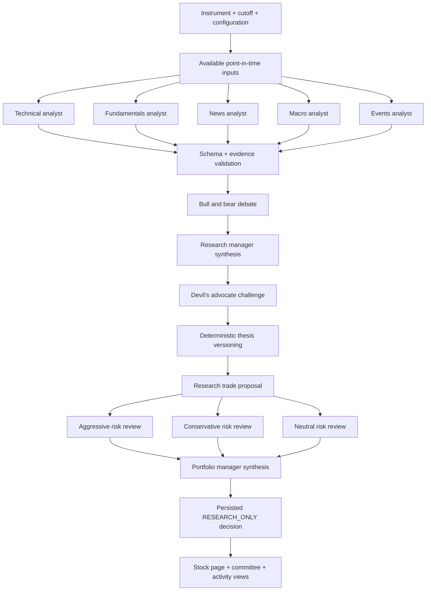
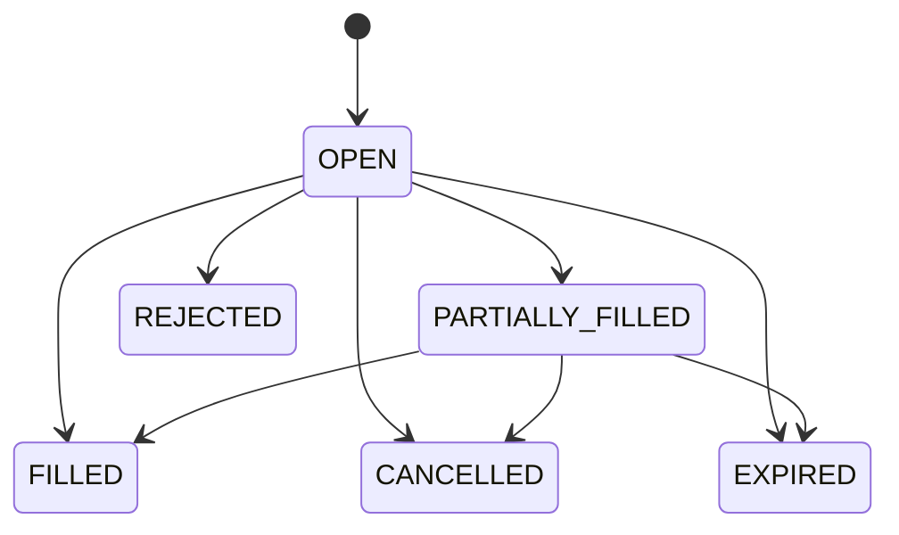
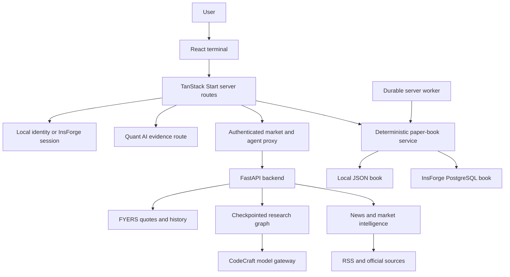

# Quant Plus

## The evidence-aware agentic research and paper-practice terminal for Indian equities

**Documentation snapshot: 23 October 2026**

> **Quant Plus connects market observation, specialist AI research, opposing viewpoints, news intelligence, deterministic risk controls, realistic paper trading and post-decision review in one continuous workflow.**

Quant Plus is designed around a simple loop:

```text
Observe → Investigate → Challenge → Understand risk → Practise → Record → Evaluate
```

It is more than a charting screen, chatbot, stock screener or balance-only simulator. It is a connected decision workspace for understanding **what the market is showing, why a thesis exists, what could invalidate it, how much risk it carries, what a simulated order actually does and what can be learned afterward**.

This document is the full product overview: what Quant Plus is, who it serves, how the agentic AI system works, why the Ripple Engine matters, how paper execution is made realistic, what has been built and which positive engineering results have been recorded.

---

## Contents

1. [Executive summary](#executive-summary)
2. [What Quant Plus is about](#what-quant-plus-is-about)
3. [The problem we solve](#the-problem-we-solve)
4. [Who it is for](#who-it-is-for)
5. [The complete user journey](#the-complete-user-journey)
6. [What makes Quant Plus stand out](#what-makes-quant-plus-stand-out)
7. [The agentic AI research system](#the-agentic-ai-research-system)
8. [Agent roles and responsibilities](#agent-roles-and-responsibilities)
9. [Quant AI: the evidence-aware copilot](#quant-ai-the-evidence-aware-copilot)
10. [The Ripple Engine](#the-ripple-engine)
11. [Market intelligence and sentiment](#market-intelligence-and-sentiment)
12. [The stock workspace](#the-stock-workspace)
13. [Decision plans and research memory](#decision-plans-and-research-memory)
14. [Deterministic paper trading](#deterministic-paper-trading)
15. [Risk, behaviour and portfolio intelligence](#risk-behaviour-and-portfolio-intelligence)
16. [Learning, replay and strategy research](#learning-replay-and-strategy-research)
17. [System architecture](#system-architecture)
18. [Data integrity and provenance](#data-integrity-and-provenance)
19. [Security and authority boundaries](#security-and-authority-boundaries)
20. [Positive engineering results](#positive-engineering-results)
21. [Product demonstration](#product-demonstration)
22. [Positioning and language](#positioning-and-language)
23. [Repository evidence](#repository-evidence)

---

## Executive summary

Quant Plus is an **Indian-equity research and paper-practice terminal** built for evidence-led decisions.

It combines:

- Provider-backed NSE market observations and historical charts.
- A multi-agent research committee covering technical, fundamental, news, macro and event perspectives.
- Bull-versus-bear debate and a devil's-advocate challenge stage.
- Multiple risk perspectives before a research decision is persisted.
- A read-only Quant AI copilot grounded in authenticated account, portfolio and market evidence.
- The Ripple Engine for connected-stock and second-order market context.
- Deterministic paper execution with server-side quotes, reservations, partial fills, charges, protections, OCO exits and settlement-aware balances.
- Risk controls that understand loss windows, concentration, liquidity, behavioural patterns and trade intent.
- Decision plans, journal entries, replay, track record, strategy research and learning tools.
- Persistent provenance, timestamps, source labels, checkpoints, audit trails and research memory.

The central product promise is continuity:

> **The evidence, reasoning, risk, practice and review belong to one workflow.**

Quant Plus keeps AI useful without giving a model silent authority over money or positions. AI contributes research, explanations and hypotheses. Deterministic application code owns paper-account mutations, risk enforcement, transaction validation, fills, charges, settlement and reconciliation.

---

## What Quant Plus is about

### The product in one sentence

Quant Plus is a research operating system for Indian equities that helps a user move from **market observation to an inspectable thesis, from thesis to a risk-aware paper decision, and from outcome to measurable learning**.

### The product in five ideas

#### 1. Understand before acting

Users can inspect the quote, chart, market context, news, events, research stages, counter-case and risk preview before creating a paper order.

#### 2. Debate instead of trusting one opinion

The agentic research system assigns explicit roles to different analytical perspectives. It preserves the evidence and disagreement behind the final research output.

#### 3. Separate intelligence from authority

The model can propose, explain and challenge. Code decides whether a paper-account mutation is valid.

#### 4. Make paper practice financially meaningful

The simulated account models cash, holdings, reservations, displayed liquidity, partial fills, charges, protections, settlement and ledger history instead of changing a single balance number.

#### 5. Preserve the path, not only the conclusion

Quant Plus stores the source, cutoff, reasoning, decision plan, order intent, quote observation, fill, charges, journal and review so the user can inspect how the result happened.

### Core principles

- **Evidence over confidence.** A confident statement is not automatically a verified fact.
- **Challenge over confirmation.** A thesis should face an explicit counter-thesis and invalidation condition.
- **Code-owned money.** Models do not directly mutate balances, positions or risk state.
- **Honest missingness.** Unknown, stale, delayed, partial and unavailable states remain visible.
- **Point-in-time thinking.** Historical research uses what was available at the relevant cutoff.
- **Practice before exposure.** Users can test a decision in a virtual account before risking capital.
- **Review as part of the product.** A decision is not complete when an order is placed.

---

## The problem we solve

Researching a stock is often fragmented:

```text
Prices in one place
Charts in another
News somewhere else
Financial context in documents
Trade notes in a spreadsheet
Risk in the user's head
Review after the fact, if it happens at all
```

That fragmentation makes it difficult to answer:

- What did the system know at the time?
- Which evidence supported the thesis?
- What did the opposing case say?
- What could invalidate the idea?
- How much risk did the proposed order carry?
- Was the paper fill based on a real observed quote?
- What happened to cash, reservations, charges and settlement?
- Was the mistake in the thesis, execution or process?

Quant Plus connects the steps into one inspectable loop:

```text
Market data
    ↓
Context and intelligence
    ↓
Specialist research
    ↓
Opposing debate and challenge
    ↓
Risk and decision plan
    ↓
Paper execution
    ↓
Ledger, settlement and protection events
    ↓
Review, replay and research memory
```

---

## Who it is for

### Serious self-directed investors and learners

People who want a repeatable process for Indian-equity research rather than an unexplained signal.

### Students and new market participants

People who need to learn how evidence, risk, costs, liquidity and execution affect a decision before risking capital.

### Quantitative and AI researchers

People who want to create hypotheses, register experiments, compare baselines, inspect failure modes and preserve research lineage.

### Process-focused paper traders

People who want a realistic practice environment with order state, reservations, charges, protections, settlement and review.

### Reviewers and educators

People who want to inspect a working example of agent orchestration, data provenance, deterministic financial state machines and empirical evaluation.

---

## The complete user journey

### 1. Orient to the market

The dashboard brings together:

- Index context.
- Market breadth.
- Sector participation.
- Volatility context.
- News and sentiment.
- Watchlist movement.
- Portfolio state.
- Next actions.
- Source and availability status.

### 2. Find an instrument

Users can search the NIFTY universe, browse market boards, inspect sectors, open watchlists or navigate directly to a provider-supported symbol.

### 3. Inspect observations

The stock workspace exposes price, change, provider, timestamp, session state, freshness, OHLCV history, volume, bid/ask, available depth, technical facts, events and news.

### 4. Open agentic research

The user can read a completed research session or start a new one. Research is checkpointed and displayed as stages rather than presented as an unexplained final paragraph.

### 5. Inspect the committee

The user can see technical, fundamental, news, macro and event perspectives, followed by bull/bear debate, manager synthesis, devil's-advocate challenge and risk review.

### 6. Ask Quant AI

The user can ask a contextual question about the instrument, market, portfolio or decision. Quant AI collects bounded read-only evidence, answers with source and freshness context, and abstains when supported evidence is insufficient.

### 7. Build a decision plan

The decision canvas connects thesis, counter-thesis, evidence, invalidation, entry, stop, target, holding period, quantity, sizing logic, expected costs and maximum acceptable loss.

### 8. Review risk

The risk preview explains planned loss, gap risk, charges, liquidity, concentration, sector exposure, reward-to-risk, events in the holding horizon and behavioural warnings.

### 9. Practise the decision

The user can place a virtual NSE cash-equity delivery order, use explicit protections, or choose a watch-only/no-trade path.

### 10. Observe what happened

The user can inspect order state, fills, quote observation, fill method, slippage, charges, reservations, ledger entries, settlement status and protection events.

### 11. Review and learn

The user can compare the original thesis with the outcome, separate thesis quality from execution quality and process quality, replay historical decisions, inspect behaviour and preserve research memory.

---

## What makes Quant Plus stand out

Quant Plus is strongest as an **unusual combination of connected capabilities and explicit authority boundaries**.

### 1. A visible research committee

The output is not just a final recommendation paragraph. The system preserves specialist reports, evidence, opposing arguments, synthesis, challenge findings, risk reviews and the final research decision.

Users can ask:

- What did the technical analyst observe?
- What did the fundamentals analyst find?
- What news mattered?
- What was the macro context?
- What did the bear case say?
- What did the devil's advocate challenge?
- Which risks changed the final decision?

### 2. A visible AI authority boundary

| Responsibility | Owner |
|---|---|
| Market observations | Provider-backed data and validation code |
| Research interpretation | Specialist AI agents and orchestration |
| Counter-case and challenge | Debate, devil's-advocate and risk stages |
| Order validity | Deterministic server code |
| Cash and holdings | Paper-book engine |
| Risk enforcement | Server-side policy and compiler |
| Fills and charges | Execution simulator and ledger |
| Account mutation | Authenticated paper-book service |

A persuasive model response cannot silently become an order or change an account balance.

### 3. Paper trading with accounting consequences

Quant Plus models integer-paise money, reservations, observed liquidity, partial fills, protections, OCO exits, itemized charges, settlement, append-only history, idempotent retries and reconciliation.

### 4. Research that remembers failure

The research system preserves hypothesis lineage, experiment identity, rejected ideas, falsification attempts, baseline comparisons, dataset state, revisions and evidence context.

The goal is to make research more inspectable and more difficult to fool.

### 5. Market context beyond a headline

The market view can combine NIFTY momentum, market breadth, sector breadth, India VIX, news sentiment, relative volume and Bank Nifty confirmation or divergence.

### 6. News connected to market relationships

News is connected to company aliases, symbols, relevance, impact, sentiment, publication time, deduplication, official announcements, price confirmation, price divergence, connected stocks and factors. This is the foundation of the Ripple Engine.

### 7. Evidence-aware conversation

Quant AI collects supported read-only evidence, gives source and freshness context to the model, buffers the answer, checks numeric claims and citations, and publishes a supported answer or abstention.

### 8. Honest system states

Quant Plus treats `observed`, `fresh`, `delayed`, `stale`, `partial`, `unavailable`, `provider error`, `insufficient coverage` and `unknown` as meaningful states rather than hiding them behind invented certainty.

### The strongest honest differentiation claim

> **Quant Plus joins AI-assisted investigation to a visible chain from evidence, thesis and risk to paper-account consequence and review.**

---

## The agentic AI research system

### Why an agentic system?

A stock thesis combines evidence types that can disagree:

- Price and volume may improve while fundamentals weaken.
- News may sound positive while the market reaction is negative.
- A stock may look attractive in isolation while the portfolio is already concentrated in the same risk.
- A scheduled event may change the meaning of a technical setup.
- A compelling narrative may fail when tested against time, source or availability.

Quant Plus assigns these perspectives explicit responsibilities so the user can inspect disagreement instead of receiving a blended, untraceable opinion.

### High-level agent graph



### What makes the system agentic

The system is agentic because it does more than call a model once. It coordinates a bounded workflow of specialized roles, shared inputs, typed outputs, checkpoints, validation, debate, challenge and synthesis.

It has:

- Role-based research responsibilities.
- Concurrent specialist work where appropriate.
- Typed research contracts.
- Evidence and reference checks.
- Checkpointed sessions.
- Deterministic session identities.
- Retry and recovery behavior.
- Persisted stage events.
- Debate and challenge stages.
- Multiple risk perspectives.
- Research-only decision output.
- Versioned thesis history.
- Budget and deadline controls.
- Warm-result retrieval for completed research.

### What the system produces

A completed research session can include:

- Directional research opinion.
- Structured thesis.
- Conviction metadata.
- Technical findings.
- Fundamental findings.
- News findings.
- Macro context.
- Event risks.
- Bull case.
- Bear case.
- Devil's-advocate challenge.
- Risk-review perspectives.
- Final rationale.
- Source and cutoff context.
- Research status and stage history.

The result is labelled as research. It is not treated as a calibrated probability or an instruction that can mutate the user's account.

### Research session lifecycle

```text
Requested
   ↓
Inputs assembled
   ↓
Specialist analysts run
   ↓
Evidence and schema checks
   ↓
Bull/bear debate
   ↓
Manager synthesis
   ↓
Devil's-advocate challenge
   ↓
Thesis version recorded
   ↓
Trader proposal
   ↓
Aggressive / conservative / neutral risk review
   ↓
Portfolio-manager synthesis
   ↓
RESEARCH_ONLY decision persisted
```

### Checkpointing and recovery

Research sessions use deterministic identities derived from the instrument, cutoff and configuration. Completed stages can be reused when the evidence and configuration still match. This reduces unnecessary repeated inference and gives the research process a progress trail.

The design supports:

- Resuming around a failed stage.
- Reusing completed findings.
- Avoiding duplicate thesis versions on retries.
- Preserving the original evidence cutoff.
- Serving completed research while a refresh runs.
- Keeping the original result visible and labelled during refresh.

### Typed contracts and evidence validation

Agent outputs use typed structures rather than free-form prose alone. Numeric signals and references are checked against supplied facts. Invalid claims can trigger correction retry and failure before synthesis when they remain invalid.

These checks cover tested classes of mistakes such as:

- Wrong sign.
- Wrong unit.
- Wrong field.
- Wrong reference.
- Unsupported numeric value.
- Cross-instrument substitution.

The result is a research system designed to make its reasoning inspectable and its failure modes visible.

---

## Agent roles and responsibilities

### Technical analyst

Interprets deterministic price and volume features, trend, momentum, exhaustion context and available historical structure.

### Fundamentals analyst

Examines available fundamental evidence within its source, period and provenance constraints.

### News analyst

Summarizes relevant available news and official announcements without treating unsupported prose numbers as verified financial facts.

### Macro analyst

Places the instrument in index, volatility, market-breadth and broader macro context where data exists.

### Events analyst

Considers known announcements, scheduled events and event risk using an explicit availability cutoff.

### Bull and bear analysts

Build and rebut opposing cases using the analyst evidence ledger. The purpose is structured disagreement, not artificial certainty.

### Research manager

Synthesizes the weight of evidence into a structured thesis and classifies the mechanism behind the view.

### Devil's advocate

Challenges the thesis, separates repeated risks from new contradictions and tests whether the thesis remains healthy or has become broken.

### Trader proposal stage

Constructs a research proposal using the thesis, challenge findings and optional portfolio context. This remains a proposal, not an execution instruction.

### Risk reviewers

Three perspectives examine the proposal:

- Aggressive.
- Conservative.
- Neutral.

The perspectives can run concurrently and are synthesized through deterministic governance rules.

### Portfolio manager

Produces the final research decision while applying code-owned restrictions and governance labels.

### Research operating-system roles

The broader research architecture also defines:

- Factor Research Agent.
- Market Microstructure Agent.
- Regime and Risk Agent.
- Event and Fundamental Agent.
- Failure Analysis Agent.
- Research Director.
- Falsification Agent.

These roles support hypothesis generation, experiment design, failure analysis, research prioritization and falsification. They are research machinery, not autonomous capital managers.

---

## Quant AI: the evidence-aware copilot

Quant AI is separate from the multi-agent stock-research graph. The research graph creates structured stock research. Quant AI is the conversational interface for supported application context.

### What Quant AI can understand

Depending on the question and provider availability, the copilot can collect:

- Paper account state.
- Holdings and exposure.
- Risk status and loss window.
- Recent orders.
- Order audit details.
- Journal context.
- Market overview.
- Stock observations.
- Validated history-derived facts.
- Relevant news tone.
- Saved research.

### Example copilot workflows

- Explain why a stock moved.
- Compare two instruments.
- Review portfolio risk.
- Review a proposed paper trade.
- Review a journal decision.
- Review a completed trade.
- Explain a technical fact.
- Summarize a research session.

### Evidence-aware answer flow

```text
User question + authenticated context
          ↓
Symbol and entity resolution
          ↓
Bounded read-only evidence collection
          ↓
Server-side model request
          ↓
Candidate answer buffered on the server
          ↓
Numeric and citation validation
          ↓
Supported answer published, or abstention returned
```

### Grounding safeguards

Evidence items carry source labels, cutoff or as-of times, citation IDs and tool success or unavailable state.

The answer checker validates citation identity, numeric field, sign, unit and instrument context. Unsupported numeric claims or invalid citations do not silently pass through to the browser.

### The most important boundary

Quant AI is read-only. It cannot place, amend or cancel paper orders. It can help the user understand a decision, but the deterministic paper-book service owns the financial state.

---

## The Ripple Engine

### What it is

The Ripple Engine is Quant Plus's system for understanding how a market event may propagate through connected companies, sectors, factors and instruments.

It answers a different question from ordinary stock news:

> **If this event matters, which other parts of the market could be affected, through what relationship and with what evidence strength?**

### Why ripple analysis matters

A company or macro event rarely belongs to only one ticker. Examples include:

- Commodity prices affecting producers, consumers and transport users.
- Currency moves affecting exporters and importers.
- Interest-rate changes affecting banks, lenders, real estate and duration-sensitive companies.
- Supply-chain disruptions affecting manufacturers and downstream companies.
- Policy announcements affecting an entire sector.
- A company announcement changing the interpretation of peers or suppliers.

### Ripple Engine pipeline

```mermaid
flowchart LR
    Headline[News or official event]
    Headline --> Normalize[Normalize source, time and identity]
    Normalize --> Classify[Classify factor, direction, impact and confidence]
    Classify --> Origin[Create verified ripple origin]
    Origin --> Graph[Traverse connected stock/factor graph]
    Graph --> Paths[Keep strongest explainable paths]
    Paths --> History[Compare with historical echoes]
    History --> UI[Show affected stocks, mechanisms and evidence]
```



### Ripple origins

Origins are created from dated, recent, non-future observations that pass validity checks. Each origin can carry:

- Unique identifier.
- Source headline or event.
- Publication time.
- Source provider.
- Affected factor or stock.
- Direction.
- Impact.
- Confidence.
- Data-quality status.
- Lock time.

### Relationship graph

The graph contains known connections between:

- Stocks.
- Sectors.
- Market factors.
- Commodities.
- Currency conditions.
- Interest-rate conditions.
- Macro themes.

The engine preserves the strongest explainable path and avoids revisiting nodes indefinitely. This keeps the result bounded and auditable.

### Historical echo

The Ripple Engine can compare current factor shocks with historical response windows when the required baseline and horizon sessions exist. It avoids inventing an outcome when a baseline or response window is unavailable, stale, invalid or future-dated.

### What the user sees

The Ripple view can show:

- The initiating event.
- The affected factor or stock.
- Connected stocks.
- Directional relationship.
- Mechanism or path.
- Strength of the connection.
- Historical echo context.
- Confidence and freshness.
- Availability state.

### Ripple Engine differentiator

The Ripple Engine turns news from a list of headlines into a connected market-context map. It gives the user a structured way to investigate second-order effects instead of stopping at the first ticker mentioned in an article.

---

## Market intelligence and sentiment

### News intelligence

The intelligence layer supports:

- Google News RSS discovery.
- Official announcement metadata.
- Source normalization.
- Company and symbol resolution.
- Relevance scoring.
- Deduplication.
- Sentiment and impact extraction.
- Event classification.
- Publication-time handling.
- Historical archive and versioning where configured.
- Bounded official attachment processing.

The pipeline distinguishes a successful empty search, provider failure, stale cached result, unavailable source and valid current observation.

### Company news context

Each relevant article can contribute according to relevance, impact, confidence and age. The UI can expose positive, neutral and negative counts, high-impact stories, top drivers, price confirmation, news/price divergence, confidence and freshness.

### Market sentiment components

The market sentiment composite can combine:

| Component | Role |
|---|---|
| NIFTY momentum | Direction and strength of the main index |
| Market breadth | Participation across the defined universe |
| Sector breadth | Whether strength is broad or concentrated |
| India VIX | Volatility and stress context |
| News sentiment | Relevant market-news direction and impact |
| Relative volume | Participation relative to available baselines |
| Bank Nifty | Confirmation or divergence from banking leadership |

The calculation is deterministic. An optional AI narrative explains the validated result but cannot change the numerical score.

### Data quality as a first-class result

The intelligence layer exposes component values, effective weights, missing components, coverage, confidence, freshness, alignment, divergence and quality status.

This lets a user understand whether a market view is broad and well observed or based on a narrow subset of available inputs.

---

## The stock workspace

The stock page is the centre of the Quant Plus decision loop.

### Market observation

- Quote and change.
- Provider and timestamp.
- Session state.
- Freshness and delayed state.
- Price range controls.
- Volume.
- Bid/ask.
- Available depth.
- Circuits and provider fields.

### Professional charting

- Candlestick, line and area views.
- Volume.
- Moving averages.
- EMA.
- RSI.
- Crosshair.
- Zoom and pan.
- Keyboard navigation.
- Event overlays.
- Research and decision markers.
- Local chart notes.

### Research and intelligence

- Multi-agent research status.
- Analyst reports.
- Thesis.
- Conviction metadata.
- Risks.
- Challenge findings.
- News intelligence.
- Event context.
- Ripple analysis.

### Decision workflow

The decision canvas connects evidence to an action or deliberate non-action:

```text
Evidence → Thesis → Risk → Paper trade / Watch-only → Review
```

### Execution

The stock ticket supports paper BUY/SELL actions, order types, quantity, entry conditions, protection levels, holding period, linked decision plan and risk review before placement.

---

## Decision plans and research memory

### Structured decision plan

A decision plan can contain expected outcome, thesis, counter-thesis, invalidation condition, evidence items, entry, stop, target, holding period, time exit, quantity, sizing logic, expected fees, expected slippage, maximum acceptable loss, market snapshot, risk preview and revisions.

### Immutable evidence context

The plan preserves the market snapshot and evidence availability timing used at decision time. This lets the user distinguish what was known then from what became known later.

### Thesis revisions

Changes to entry, stop, target, time exit, holding period or quantity are recorded as revisions. The system can show how a plan changed rather than only exposing its final state.

### Research memory

The broader research system stores hypotheses, experiments, evidence bundles, falsifiers, rejected ideas, version history, dataset state, research fingerprints and promotion or rejection state.

The result is an institutional-memory pattern for an individual researcher: the platform can remember not only what was tried, but why it changed or failed.

---

## Deterministic paper trading

### Scope

The primary trading scope is virtual NSE cash-equity delivery. Configured market providers supply observations; Quant Plus records paper orders and fills. The platform does not submit orders to a broker or exchange.

This boundary is intentional. It lets the product focus on decision quality, execution realism, risk controls and review without pretending that a research model should directly control live capital.

### Paper-book state

The durable book tracks account, cash, holdings, orders, fills, reservations, protections, ledger, events, intent fingerprints, risk-day state, worker lease, alerts, journal records, conversations and research items.

### Order state machine



### Execution mechanics

| Area | Quant Plus behavior |
|---|---|
| Quote authority | The server obtains the execution quote; browser-supplied prices are not authoritative. |
| Eligibility | Source, freshness, session and required quote fields are checked. |
| Bid/ask | Valid spread observations are used where available. |
| Fallback | Last-trade and slippage assumptions are recorded explicitly when necessary. |
| Liquidity | Displayed quantity and participation can limit a fill. |
| Market orders | Supported market behavior is immediate-or-cancel under the observation model. |
| Limit and stop orders | Persist, reserve resources and execute when eligible. |
| Reservations | Buys reserve cash; sells reserve shares; cancellation and expiry release resources. |
| Amendments | Fresh observations, version checks and renewed risk validation are required. |
| Protections | Stop, target and trailing logic create deterministic exit intents. |
| OCO | Stop and target exits share a reservation and cancel their sibling after a fill. |
| Baskets | Server-side preflight evaluates legs sequentially against a copied book. |

### Financial realism

The paper engine models integer-paise balances, itemized STT, exchange charges, SEBI fees, stamp duty, GST, explicit brokerage and DP assumptions, settled and unsettled shares, pending sale proceeds, withdrawable cash, clearing-day rules and FIFO-style lot accounting where supported.

### Idempotency and reconciliation

Every mutation can carry an intent identifier and fingerprint. Retrying the same request replays the same response instead of creating duplicate financial effects. Reusing an intent with changed order details is rejected as a conflict.

The book reconciliation checks relationships such as:

```text
cash = ledger balance
positions = remaining fills
order fills = fill records
reservations cover open obligations
event sequence is unique and monotonic
```

### Durable worker

The server worker maintains eligible state independently of an open browser tab while the application server is running. Responsibilities include DAY-order expiry, position marks, risk-day anchoring, resting-order fills, stop and target protections, alerts and settlement maintenance.

---

## Risk, behaviour and portfolio intelligence

### Pre-trade risk preview

The compiler can calculate or display:

- Reference price.
- Fill range.
- Turnover.
- Spread cost.
- Expected slippage.
- Fees.
- Participation percentage.
- Top-of-book percentage.
- Worst partial-fill quantity.
- Position percentage after the order.
- Sector percentage after the order.
- Beta exposure.
- Stop distance.
- Planned loss.
- Gap loss.
- Scenario losses.
- Daily budget usage.
- Reward-to-risk.
- Events in the planned horizon.
- Behavioural warnings.

### Policy controls

The risk centre supports controls such as maximum order value, maximum position percentage, daily loss limit, confirmation threshold, trading pause, new-exposure limits, sector concentration warnings, liquidity warnings and data-quality warnings.

Risk-reducing exits remain distinct from new exposure. Quant Plus keeps those paths separate so a restriction on new risk does not prevent a user from reducing existing risk.

### Behavioural intelligence

The behaviour layer can identify patterns such as increasing size after losses, rapid re-entry, moving a stop away from risk, ignoring an invalidation condition and repeating the same process failure.

The purpose is not to shame the user. It is to create useful friction and make process quality visible.

### Portfolio intelligence

Portfolio surfaces can show allocation, concentration, contribution, sector exposure, risk contribution, stress and scenario context, liquidity context, correlation-related analysis and digital-twin what-if views.

---

## Learning, replay and strategy research

### Learning path

Quant Plus includes learning experiences for investor profile, risk capacity and tolerance, market concepts, AI-assisted tutoring, concept checks, company and IPO simulation, dilution and share mechanics.

### Historical replay

Replay uses a separate practice account and hides future bars from the decision point. It supports historical cursors, next-bar entry behavior, hidden future information, cost-aware execution, fill limits, gap-through-stop behavior and separate account state.

### Strategy Lab

The strategy-research path supports:

- Typed hypotheses.
- Allowlisted strategy definitions.
- Baseline comparison.
- Walk-forward analysis.
- Cost modeling.
- Placebo tests.
- Sensitivity analysis.
- Regime segmentation.
- Concentration checks.
- Data-quality checks.
- Shadow experiments.
- Promotion and rejection states.

### Track Record

The track-record workflow distinguishes matured forecasts, unresolved forecasts, baseline comparison, calibration, abstention and segment-level behavior. A prediction is treated as an experiment that needs an outcome definition and a mature evaluation window.

### Review and attribution

Post-decision review can separate:

1. **Thesis quality** — Was the underlying interpretation supported?
2. **Execution quality** — Did the paper order behave as planned?
3. **Process quality** — Did the user follow the defined plan?

This is more useful than treating every result as only a profit or loss number.

---

## System architecture

### Application layers



### Three application planes

| Plane | Responsibility | Authority |
|---|---|---|
| Observation | Quotes, candles, news, documents, timestamps and data quality | Providers plus validation and provenance code |
| Research | Specialist reasoning, debate, explanations, hypotheses and evaluation | Agentic research graph and research memory |
| Paper-account execution | User intent, risk, orders, fills, charges, settlement and balances | Deterministic server-side paper-book service |

### Frontend stack

- React 19.
- TypeScript.
- TanStack Router.
- TanStack Start.
- TanStack Query.
- Vite.
- Nitro Node-server output.
- Tailwind CSS.
- Radix UI primitives.
- Lightweight Charts.
- Playwright.
- Node test runner.

### Backend and intelligence stack

- FastAPI.
- Pydantic schemas.
- FYERS market integration.
- CodeCraft model gateway.
- Checkpointed research graph.
- SQLite research, news and history stores.
- Parquet research datasets.
- News and document acquisition modules.
- Deterministic market and portfolio analytics.

### Persistence modes

#### Local workspace

- Local JSON book.
- Cooperative locking.
- Atomic replacement.
- Backups.
- Migration and verification tools.
- Local-first development and browser tests.

#### Hosted InsForge

- Authenticated user sessions.
- PostgreSQL paper-book state.
- Owner-scoped reads.
- Row-level security.
- Relational projections.
- Compare-and-swap book commits.
- Shared deterministic commands.

The two modes are deliberate alternatives selected by configuration rather than an uncontrolled mixture of state.

---

## Data integrity and provenance

### Multiple meanings of time

Quant Plus distinguishes:

| Time field | Meaning |
|---|---|
| Market/event time | When the trade, bar or event occurred |
| Publication time | When the source published the information |
| First-seen time | When the system observed the source |
| Available-at time | When a record became eligible for analysis |
| Calculation time | When a score or explanation was generated |

A fresh calculation timestamp cannot make an old observation fresh. A filing period end cannot prove the filing was publicly known on that date. This distinction is central to honest research.

### Provenance fields

Where available, Quant Plus preserves source, provider, observation time, publication time, first-seen time, available-at time, calculation time, cutoff, confidence, coverage, freshness, derived or observed status, source URL or document identity and hash or version information.

### Data-quality behavior

The system prefers explicit status over silent repair:

- Invalid bars are dropped rather than repaired.
- Duplicate or out-of-order bars are rejected.
- Future-dated announcements are quarantined.
- Stale observations remain labelled.
- Delayed display data does not become execution-eligible.
- Missing inputs remain unavailable.
- Provider failures are different from empty results.
- Source disagreement remains visible.

### Official-document handling

Where configured, official attachment processing uses host allowlists, safe retrieval rules, download limits, timeouts, bounded concurrency, immutable raw bytes, hashes, parser isolation, bounded PDF/XML/XBRL parsing and explicit unavailable states on failure.

---

## Security and authority boundaries

### Server-side credentials

Provider credentials, internal keys, model keys and hosted service configuration remain server-side. The browser receives only the data needed for the user-visible workflow.

### Authentication

The hosted path supports signup, sign-in, email verification, one-time-code verification, resend, sign-out, session retrieval, refresh and account-change cache invalidation.

### Paper-account protection

Browsers do not directly update cash or holdings. Paper mutations pass through authenticated server routes, server-side validation and the deterministic book service.

### AI restrictions

The research graph outputs research-only decisions. Quant AI is read-only. Neither path can silently place live broker orders.

### Hosted database protection

The InsForge design includes owner-scoped access, row-level security, restricted write paths and compare-and-swap book commits to protect against concurrent overwrites.

---

## Positive engineering results

This section highlights positive, recorded outcomes from the repository's verification and implementation evidence. These are engineering and workflow results, not promises of investment returns or future prediction accuracy.

### Persisted, inspectable research

Quant Plus surfaces actual persisted research sessions, analyst reports, stage events, checkpointed progress, challenge findings and final research-only decisions.

### Server-authoritative paper mutations

Paper orders cross an authenticated server boundary. The server obtains the provider quote, validates the request, rechecks risk and protection constraints and records the resulting financial state.

### Durable accounting structure

The paper book records account state, holdings, orders, fills, reservations, protections, ledger entries, event history, idempotency intents, risk-day state and worker state.

### Retry safety

Intent fingerprints prevent retries from creating duplicate orders or duplicate financial effects. A changed request using an existing intent is rejected as an idempotency conflict.

### Deterministic risk visibility

The platform can explain planned loss, gap risk, fees, liquidity, concentration, sector exposure, reward-to-risk, event risk and behavioural warnings before a paper order is placed.

### Durable worker maintenance

The worker handles eligible expiry, marks, resting fills, protections, alerts and settlement maintenance independently of the browser tab while the application server is running.

### InsForge isolation

The repository records a fresh live two-user InsForge isolation run with **29/29 checks passed**, covering owner-scoped reads, browser-write rejection, compare-and-swap conflict handling, hosted settlement/replay and reconciliation refusal.

### Accelerated paper-session soak

The recorded accelerated soak completed:

| Measure | Result |
|---|---:|
| Simulated sessions | 10 |
| Iterations | 130 |
| Requests | 121 |
| DAY-order expiries | 31 |
| Explicit per-session expiry proofs | 10 |
| Reported server/reconciliation/duplicate-settlement errors | 0 |
| Route p95 under the soak workload | 254.9 ms |

### Broad automated verification

The repository's dated verification record includes:

- 74 frontend and domain tests in the recorded release check.
- 316 intelligence tests.
- 473 backend tests.
- 49 Playwright browser tests covering canonical routes, accessibility checks and local UI flows.
- TypeScript checking.
- Production build verification.
- ESLint verification.
- Proxy authentication checks.
- Paper price and route checks.
- Settlement checks.
- Migration checks.
- Fault-injection checks.
- Hosted authentication checks.
- Decision-plan checks.

### Completed-research retrieval

The recorded benchmark made 100 in-process reads of a completed HDFCBANK research result in an isolated database:

| Metric | Result |
|---|---:|
| Median retrieval | 2.594 ms |
| p95 retrieval | 4.829 ms |
| Maximum retrieval | 7.017 ms |
| Model calls during retrieval | 0 |
| Analyst reports returned | 5 |

This demonstrates the value of checkpointing and warm-result delivery.

### Local paper-book benchmark

The recorded local engine/storage benchmark showed:

| Operation | p50 | p95 |
|---|---:|---:|
| Resting-limit acknowledgement | 146.227 ms | 253.721 ms |
| Holdings read | 18.231 ms | 24.480 ms |
| Account read | 17.991 ms | 23.786 ms |
| Orders-page read | 18.004 ms | 23.272 ms |
| Worker tick | 31.500 ms | 40.774 ms |

### Live intelligence snapshot

The recorded live frontend intelligence check achieved:

- NIFTY breadth across 50/50 equities.
- Sector breadth across 8/8 sectors.
- Fresh India VIX input.
- 12 usable volume samples against a minimum of 10.
- All 7 composite market-sentiment components available.
- Data quality recorded as `GOOD / 99`.

### Strong validation culture

The project includes positive implementation evidence for calendar parity, session boundaries, order expiry, marked loss windows, migration quarantine, fault recovery, duplicate-intent protection, worker lease behavior, settlement behavior, hosted authentication, market subscription handling, chat streaming and evidence grounding.

---

## Product demonstration

### Demo title

**From headline to evidence-backed paper decision**

### Demo flow

1. Open the Quant Plus dashboard.
2. Show index context, breadth, sector participation and source health.
3. Open a stock from the market board.
4. Show quote source, timestamp, freshness and chart history.
5. Open the Ripple Engine and show connected stocks or factors.
6. Start or open a completed research session.
7. Walk through the specialist analyst results.
8. Show the bull and bear cases.
9. Show the devil's-advocate challenge.
10. Ask Quant AI a grounded question about the stock or portfolio.
11. Open the decision canvas.
12. Enter thesis, counter-thesis, invalidation, entry, stop and target.
13. Show the deterministic risk preview.
14. Place a paper order.
15. Show the server-authoritative order state and fill evidence.
16. Open the ledger and show charges, reservations and settlement state.
17. Open the review surface.
18. Separate thesis outcome, execution outcome and process outcome.
19. End with the research-memory and replay path.

### Demo message

> “Quant Plus does not ask the user to trust an AI answer. It lets the user inspect the evidence, see the disagreement, understand the risk, practise the action and review the result.”

---

## Positioning and language

### Recommended one-line description

> **Quant Plus is an evidence-aware agentic research and paper-practice terminal for Indian equities.**

### Recommended short description

> Quant Plus connects provider-backed market data, multi-agent stock research, opposing viewpoints, news intelligence, Ripple Engine context, grounded Quant AI, deterministic paper trading, risk controls and post-decision review in one workspace.

### Recommended product narrative

> Researching a stock should not end with a chart and a confident paragraph. Quant Plus gives users a complete decision workflow: observe the market, investigate evidence, challenge the thesis, understand risk, practise the trade, inspect the accounting and learn from the outcome.

### Recommended differentiation statement

> Quant Plus stands out by joining agentic research and realistic paper-account mechanics under a strict authority boundary: AI can research and explain, while deterministic server code controls risk, orders, fills, balances and reconciliation.

### Recommended Ripple Engine statement

> The Ripple Engine maps how news and market shocks can propagate through connected stocks, sectors and factors, then shows the relationship path, evidence quality and historical context.

### Recommended agentic AI statement

> Quant Plus uses a visible research committee of specialist agents, debate roles, a devil's advocate and multiple risk perspectives to turn fragmented market evidence into an inspectable research artifact.

### Recommended trust statement

> Quant Plus is designed to make uncertainty visible. Stale data, delayed data, missing coverage, provider failures and unsupported claims are represented as states instead of being silently converted into certainty.

### Language to use

- Evidence-aware.
- Research-only.
- Deterministic paper execution.
- Inspectable.
- Provider-backed.
- Source and freshness labelled.
- Risk-aware.
- Designed for measurable learning.
- Connected market context.
- Visible agentic workflow.

### Language to avoid

Avoid unsupported claims such as:

- “Guaranteed returns.”
- “Autonomous profitable trader.”
- “90% accurate AI.”
- “The best trading platform.”
- “The first system to do this.”
- “Risk-free trading.”
- “The AI knows what the market will do.”

### The strongest honest claim

> **Quant Plus is not trying to make trading look effortless. It is trying to make the decision process visible, testable and learnable.**

---

## Repository evidence

### Product and architecture

- [README.md](README.md)
- [PROJECT_PRESENTATION.md](PROJECT_PRESENTATION.md)
- [Plan.md](Plan.md)
- [AGENT_INTEGRATION.md](AGENT_INTEGRATION.md)
- [INTELLIGENCE.md](INTELLIGENCE.md)

### Verification and implementation evidence

- [VERIFICATION.md](VERIFICATION.md)
- [IMPLEMENTATION_STATUS.md](IMPLEMENTATION_STATUS.md)
- [ROADMAP_IMPLEMENTATION_20261015.md](ROADMAP_IMPLEMENTATION_20261015.md)
- [INSFORGE_MIGRATION.md](INSFORGE_MIGRATION.md)

### Product research and positioning

- [Feature inventory](research_notes/Quant%20Plus%20market%20differentiation/feature%20inventory.md)
- [Positioning and gaps](research_notes/Quant%20Plus%20market%20differentiation/positioning%20and%20gaps.md)
- [Technical differentiators](research_notes/Quant%20Plus%20market%20differentiation/technical%20differentiators.md)
- [Future moat codebase fit](research_notes/Future%20Trading%20Moat/codebase%20fit.md)
- [Agentic recommendation redesign](research_notes/Agentic%20Recommendation%20Redesign/blueprint.md)

### Core implementation areas

- `src/components/app/stocks/StockDetail.tsx`
- `src/components/app/stocks/AgentPrediction.tsx`
- `src/components/app/stocks/DecisionCanvas.tsx`
- `src/components/app/stocks/ProfessionalChart.tsx`
- `src/components/app/stocks/StockRipplePanel.tsx`
- `src/components/app/pages/RipplePage.tsx`
- `src/components/app/pages/DecisionLifecyclePage.tsx`
- `src/components/app/pages/TrackRecordPage.tsx`
- `src/components/app/pages/StrategyLabPage.tsx`
- `src/lib/quant/risk-compiler.ts`
- `src/lib/quant/decision-plan.ts`
- `src/lib/quant/behavior.ts`
- `src/lib/paper-book/commands.ts`
- `src/lib/paper-book/engine.ts`
- `src/lib/paper-book/types.ts`
- `src/routes/api/chat.ts`
- `src/routes/api/paper/$.ts`
- `src/routes/api/agent/$.ts`
- `backend-extension/quantplus_intelligence/`

---

## Final summary

Quant Plus is a connected, evidence-aware decision environment for Indian-equity research and paper practice.

Its strongest contribution is the combination of:

1. Provider-backed market observation.
2. Visible multi-agent research.
3. Bull/bear debate and devil's-advocate challenge.
4. News, event, sentiment and Ripple Engine context.
5. Read-only evidence-grounded Quant AI.
6. Deterministic risk and behavioural controls.
7. Realistic paper accounting and execution state.
8. Durable audit history and research memory.
9. Replay, strategy research and post-decision review.

The result is a product that treats every trade idea as a process to understand, challenge, practise and learn from.

> **Quant Plus: understand the market, challenge the thesis, practise the decision.**
